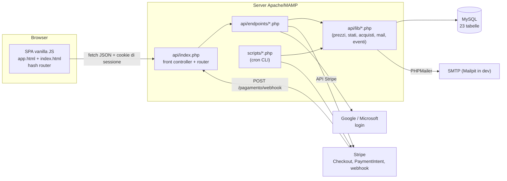

# 01 – Architettura

## A cosa serve
Dà la **visione d'insieme** di BuyPool: i componenti (browser, API PHP, MySQL, Stripe, Google/Microsoft, SMTP), come
passa una richiesta dal browser al database e ritorno, come sono organizzate le cartelle e quali convenzioni segue il
codice (nomi, risposte JSON, errori, sessioni, ruoli). È il documento da leggere per primo. I dettagli di ogni area
sono nei documenti successivi (02-08).

---

## 1. Visione d'insieme
BuyPool è una piattaforma di **acquisti di gruppo**: più clienti aderiscono a un prodotto, il prezzo scende al crescere dei pezzi (scaglioni); si paga un acconto subito e il saldo alla chiusura.



| Livello | Cosa c'è | Dove |
|---|---|---|
| Frontend | SPA a moduli ES, router a hash, nessun build | `frontend/` (`07-frontend.md`) |
| API | PHP senza framework: un front controller, 20 file di endpoint, 14 librerie | `api/` (`03-endpoint-api.md`) |
| Database | MySQL/InnoDB, accesso solo con PDO e query preparate | `02-database.md` |
| Servizi esterni | Stripe (pagamenti), Google e Microsoft (login), SMTP (email) | `05`, `06`, `08` |
| Processi periodici | script PHP da riga di comando + una chiusura via HTTP | `scripts/`, `campagne_chiusura` |

## 2. Flusso di una richiesta
```mermaid
sequenceDiagram
  participant B as Browser (api.js)
  participant R as api/index.php
  participant E as endpoint (es. mie_acquisti)
  participant L as lib (es. acquisti.php)
  participant D as MySQL
  B->>R: GET /buypool/api/mie/acquisti (cookie PHPSESSID)
  R->>R: session_start, percorso(), abbina(rotta)
  R->>E: chiama la funzione della rotta
  E->>E: richiedi_cliente() (sessione + DB)
  E->>L: acquisti_dell_utente(), acquisti_conteggi()
  L->>D: SELECT … (PDO prepare)
  D-->>L: righe
  L-->>E: array classificati
  E-->>B: json_ok → {"ok":true,"dati":{…}}
  Note over R,B: AppError → {"ok":false,"errore":{codice,messaggio}}; altre eccezioni → 500 ERRORE_INTERNO
```
Punti chiave nel codice:
1. `api/index.php:11-18` imposta timezone `Europe/Rome`, `display_errors=0`, cookie di sessione `httponly`+`SameSite=Lax` e avvia la sessione.
2. `index.php:20-55` fa `require` esplicito di tutte le librerie e di tutti gli endpoint (nessun autoloader per il codice applicativo).
3. `index.php:196-209`: il webhook Stripe è gestito prima del router; poi si scorre la tabella `$rotte` e si chiama la funzione con i parametri `{id}`/`{token}` estratti.
4. `index.php:215-220`: `AppError` → JSON d'errore con codice HTTP; qualunque altra eccezione → log e 500 generico.

## 3. Struttura delle cartelle e responsabilità
| Cartella | Responsabilità |
|---|---|
| `api/endpoints/` | un file per area; ogni funzione = una rotta: autenticazione, validazione dell'input, chiamata alle librerie, risposta JSON |
| `api/lib/` | regole di business riusabili, **senza HTTP**: calcoli puri (`prezzi.php`, `aumento.php`, `stato.php`), classificazione acquisti, email ed eventi |
| `api/migrations/` | modifiche allo schema, con rollback, applicate a mano |
| `scripts/` | processi da cron: saldi scaduti, scadenza proposte, pulizia foto |
| `frontend/js/pages/` | una pagina per rotta; `components/` per UI riusabile; moduli "puri" alla radice di `js/` (testabili con Node) |
| `tests/` | test standalone (nessun framework) |
| `docs/` | documentazione |

**Principio di progetto osservabile:** la regola di business sta nelle funzioni pure di `api/lib/` e il frontend ne ha, dove serve, una copia per le **stime** (es. `saldo-stima.js`); la verità è sempre il server. I test esistenti coprono soprattutto queste funzioni pure.

## 4. Convenzioni
| Tema | Convenzione | Dove |
|---|---|---|
| Lingua | codice, commenti, messaggi e nomi di dominio **in italiano** (`campagne_crea`, `richiedi_login`) | ovunque |
| Nomi | funzioni `snake_case` prefissate dall'area (`pagamento_*`, `campagne_*`, `evento_*`); costanti `MAIUSCOLO` | – |
| Risposte | `{"ok":true,"dati":…}` / `{"ok":false,"errore":{"codice","messaggio","campi"?}}` | `lib/risposta.php:27-45` |
| Errori | `throw new AppError(CODICE, messaggio, http, campi)`; codici in `MAIUSCOLO_SNAKE` (es. `GIA_PARTECIPI`, `CAMPAGNA_SCADUTA`) | `risposta.php:11` |
| Query | solo PDO con `prepare`/`execute`, `FETCH_ASSOC`, `EMULATE_PREPARES=false`, transazioni con `FOR UPDATE` dove serve | `lib/db.php:19-23` |
| Soldi | `float` PHP con `round(…, 2)` per voce; in centesimi interi per Stripe (`(int)round($x*100)`) | `prezzi.php`, `pagamento.php` |
| Date | `DATETIME` locali (Europe/Rome), confrontate con `NOW()` MySQL | `index.php:7` |
| Autenticazione | sessione PHP (cookie); il frontend invia un `Bearer` finto che il server ignora | `08-sicurezza-e-ruoli.md` |
| Ruoli | `cliente`, `fornitore`, `admin` in `utenti.ruolo` e `$_SESSION['ruolo']`; controlli inline (`sono_admin()`) o con `richiedi_*` | `lib/auth.php` |
| CSRF / CORS | CSRF solo sul voto alle proposte; nessun CORS (stesso origin) | `auth.php:62-76` |
| Terminologia | testi visibili "gruppo/adesione"; nomi interni "colletta/campagna/prenotazione" | `10-glossario.md` |
| Idempotenza | `eventi_stripe`, `email_inviate`, UNIQUE sui pagamenti e sulle adesioni, `chiusura_data`, `idempotency_key` sui rimborsi | `05`, `06` |

## 5. Dove vivono le regole di business
| Regola | File |
|---|---|
| Acconto, saldo, commissione, scaglioni | `api/lib/prezzi.php`, `api/lib/aumento.php`, `api/endpoints/pagamento.php` |
| Stato del gruppo | `api/lib/stato.php` |
| Classificazione degli acquisti e contatori della dashboard | `api/lib/acquisti.php` (funzione unica per "I miei acquisti" e Dashboard) |
| Chiusura, rimborsi, ordine al fornitore | `api/endpoints/campagne.php` |
| Email e notifiche idempotenti | `api/lib/notifiche_eventi.php`, `api/lib/mail.php` |
| Regole delle proposte | `api/lib/proposte_regole.php` |
| Sede di ritiro predefinita | `api/lib/sede.php` |

## 6. Deploy e processi
Non c'è un file di CI né un processo supervisore. Per il funzionamento completo servono: un cron orario su `scripts/saldi_scaduti.php`, un cron periodico sulla chiusura dei gruppi (`POST /campagne/chiusura?secret=…`), uno su `scripts/scadenza_proposte.php`, il webhook Stripe raggiungibile e la migrazione `2026-10-21_email_notifiche.sql`. Le guide esistenti (`docs/ops/09-guida-deploy.md`, `docs/ops/10-runbook.md`) vanno rilette alla luce di queste note.

## Domande che potrebbero farmi
1. **Che architettura ha BuyPool?** Un'unica applicazione: SPA JavaScript che parla con un'API PHP senza framework, con MySQL e servizi esterni (Stripe, OAuth, SMTP).
2. **Perché PHP senza framework?** Scelta di progetto (motivazione presunta: controllo totale e semplicità didattica); il costo è la gestione manuale di routing, autenticazione e validazione.
3. **Come passa una richiesta?** Browser → `api/index.php` → funzione dell'endpoint → librerie → PDO/MySQL → `json_ok`.
4. **Dove sta la logica di business?** In `api/lib/` (funzioni pure) e nelle funzioni degli endpoint che orchestrano pagamenti e chiusura.
5. **Come gestite gli errori?** Con `AppError` e codici testuali; tutto il resto diventa un 500 generico con log.
6. **Come si separano i ruoli?** Sessione con ruolo e controlli `richiedi_*`/`sono_admin()` in ogni endpoint.
7. **Quali processi periodici esistono?** Chiusura dei gruppi, saldi scaduti (promemoria 24 h, rimborso 48 h), scadenza proposte, pulizia foto.
8. **Come si garantisce che il frontend non decida i prezzi?** Il server ricalcola tutto; il browser invia solo gruppo, quantità e modalità di consegna.
