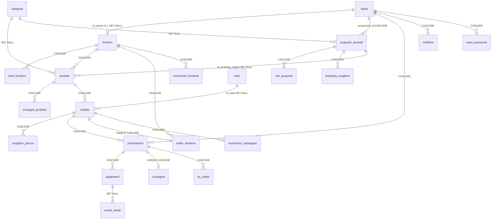

# 02 – Database

## A cosa serve
Descrive le **23 tabelle** del database MySQL `buypool` (InnoDB, utf8mb4): a cosa servono, colonne principali,
chiavi, vincoli, valori ammessi per gli stati e quali file PHP le leggono o scrivono. Indica anche tabelle,
colonne e valori che il codice non usa e le incoerenze fra `schema.sql`, migrazioni e database reale.
Metodo: lettura di `api/schema.sql`, `api/seed_data.sql`, `api/migrations/*`, dump `api/buypool.sql`
(solo struttura, **nessun dato personale riportato**), `information_schema` del DB locale (MySQL 5.7.24, porta 8889) e grep del codice.
Nei documenti "colletta" = **gruppo**, "prenotazione" = **adesione**. `S:nn` = riga di `api/schema.sql`.

---

## 1. Fonti dello schema e differenze
| File | Cosa è | Note |
|---|---|---|
| `api/schema.sql` (424 righe) | schema "finale" | l'intestazione dice "17 tabelle" (S:2) ma ne contiene 23 |
| `api/buypool.sql` (1481 righe) | dump phpMyAdmin del DB di sviluppo, 21/10/2026 | contiene **dati reali/demo** (utenti, pagamenti, email) – **non versionato** (`git status`: `??`) **ma non in `.gitignore`** → rischio di commit accidentale |
| `api/seed_data.sql` (32 righe) | seed minimale: 4 categorie, 3 fornitori, 3 sedi, 5 prodotti, 3 gruppi, 9 scaglioni | **non funziona così com'è** (vedi §4) |
| `api/migrations/*.sql` | 3 migrazioni con `_down` | già incorporate in `schema.sql` e applicate al DB reale |

Incoerenze verificate (schema ↔ DB reale ↔ codice):
1. `prodotti.immagine_url` esiste nel DB e nel dump, **non** in `schema.sql` né nelle migrazioni, e **nessun file PHP la usa** (le immagini sono in `immagini_prodotto`).
2. La tabella `collette_backup_20261007` esiste solo nel DB e nel dump (copia di `collette` senza chiavi); nessun file del repo la nomina.
3. In `schema.sql`, `recensioni_campagna` (S:156) è creata **prima** di `collette` (S:215) pur avendo una FK verso di essa: su un DB vuoto lo script fallisce.
4. `seed_data.sql:7` inserisce `fornitori.trust_score`, colonna **inesistente**; i gruppi del seed puntano all'utente 2, che il seed non crea.
5. I `CHECK` dei voti 1–5 (S:150, S:166) sono ignorati da MySQL 5.7: l'intervallo è garantito solo dal PHP (DA VERIFICARE in `recensioni.php`).
6. Gli ENUM di `schema.sql` e DB coincidono per tutte le tabelle.

## 2. Diagramma ER (relazioni principali)

Senza FK (polimorfici): `notifiche.id_riferimento` (con `tipo_riferimento` ∈ colletta/prenotazione/proposta) ed `email_inviate` (`riferimento_tipo` + `riferimento_id` + `id_utente`, **nessuna FK**).

**Rischi di cascata:** eliminare un fornitore o un prodotto cancella a cascata gruppi → adesioni → pagamenti. L'unico controllo applicativo è l'`HA_STORICO` sull'eliminazione utente (`api/endpoints/utenti.php:86-95`) e `HA_PAGAMENTI` su `campagne_elimina` (`campagne.php:570-579`).

## 3. Le tabelle

> Legenda: **R** = legge, **W** = scrive. Le righe sono quelle del grep sul nome tabella; la lista dei lettori è indicativa, non esaustiva.

### Gruppo "persone"
#### `utenti` (S:12-33) – account di clienti, fornitori, admin
- `id` PK; `nome`, `cognome`; `email` UNIQUE; `password_hash` (NULL per OAuth); `telefono`, `indirizzo`, `cap`, `citta`, `provincia`; `tipo` ENUM(`privato`,`b2b`) default `privato`; **`ruolo` ENUM(`cliente`,`fornitore`,`admin`)** default `cliente`; **`stato` ENUM(`attivo`,`sospeso`)**; `google_id`, `microsoft_id`, `stripe_customer_id` (tutti UNIQUE); `partita_iva`, `codice_fiscale`; `data_iscrizione`; `privacy_accettata_at`. Indice `idx_utenti_ruolo`.
- W: `auth.php` (registrazione `:30`, Google `:96`, Microsoft `:160`), `fornitori.php:204,267`, `password.php:125`, `profilo.php:66,90`, `pagamento.php:619` (customer Stripe), `utenti.php:44,63,93`.
- `sospeso` è controllato da `richiedi_utente_attivo` (`api/lib/auth.php:89-97`).
- Duplicazioni di significato: `utenti.partita_iva` ↔ `fornitori.piva` (nessuna sincronizzazione); indirizzo anagrafico ↔ `consegne.indirizzo_consegna` (copia voluta).

#### `reset_password` (S:401-409)
`id`, `id_utente` (CASCADE), `token` UNIQUE, `scadenza`, `usato`, `data_creazione`. R/W solo `password.php` (INSERT `:60`, UPDATE `:56,126`). Nessuna pulizia dei token scaduti. Token salvato in chiaro (DA VERIFICARE se `password.php` salva un hash).

#### `fornitori` (S:38-54)
`id`; `nome_azienda`; `email_contatto`, `telefono`, `indirizzo`, `descrizione`, `logo_url`, `sito_web`; `partner_pubblico` (default 1); `num_campagne` (default 0); `data_partnership`; `id_utente` UNIQUE (FK SET NULL); `piva`; `categoria` (testo libero, non FK).
- W: solo `fornitori.php` (INSERT `:45`, UPDATE `:104,209,269,323`). R: `campagne.php`, `catalogo.php`, `dashboard.php`, `lib/auth.php:36`, ecc.
- ⚠ `num_campagne` è **letta ma mai scritta** (le API pubbliche la ricalcolano con COUNT: `campagne.php:201`, `catalogo.php:10`) → valore stantio in `fornitori.php`. `partner_pubblico`, `data_partnership` mai scritte oltre al default.

#### `inviti_fornitore` (S:59-68)
`id`, `id_fornitore` (CASCADE), `email`, `token` UNIQUE, `scadenza`, `usato` (0/1), `data_creazione`. R/W solo `fornitori.php` (INSERT `:129`; UPDATE `:125` invalida i precedenti, `:216` segna usato).

### Gruppo "catalogo"
#### `categorie` (S:73-77) – `id`, `nome` UNIQUE, `descrizione`
Nessuna scrittura da codice (solo seed/phpMyAdmin); R: `proposte.php` (`GET /categorie`), `campagne.php`, `catalogo.php`, `dashboard.php`.

#### `sedi` (S:82-89) – punti di ritiro
`id_sede` PK (nome diverso dalle altre tabelle), `nome`, `indirizzo`, `citta`, `telefono`, `orari`. Nessuna scrittura da codice. Sede predefinita = `MIN(id_sede)` (`api/lib/sede.php:9-12`).

#### `prodotti` (S:183-198)
`id`; `id_fornitore` (CASCADE); `id_categoria` (SET NULL); `id_proposta_origine` (SET NULL); `nome`; `descrizione`; `prezzo_unitario`, `prezzo_base`; `quantita_minima` (default 1); **`stato` ENUM(`attivo`,`archiviato`)**; `data_creazione`. Indici su fornitore e categoria.
- W: **solo INSERT** (`campagne.php:658`, `proposte.php:478`); nessun `UPDATE prodotti` nel codice. `archiviato` mai scritto né letto.
- Prezzi e minimo sono **duplicati** fra `prodotti` e `collette` (copiati alla creazione, poi divergono; comanda la colletta).
- ⚠ `proposte_auto_crea` non copia `id_categoria` né `prezzo_base` nel prodotto (`proposte.php:478`).

#### `immagini_prodotto` (S:203-210)
`id`, `id_prodotto` (CASCADE), `url`, `ordine`, `principale`. W: `campagne.php:730,1015-1053`, `prodotti.php:66,93,97`, `proposte.php:487`. Non c'è vincolo che garantisca una sola immagine principale (solo logica applicativa).

### Gruppo "proposte"
#### `proposte_prodotti` (S:94-120)
- `id_proposta` PK; `proponente_tipo` ENUM(`cliente`,`fornitore`,`admin`); `proponente_id` (CASCADE); `nome_prodotto`; `descrizione`; `id_fornitore_suggerito`; `id_categoria`; `id_admin_gestione`; `tot_voti` (denormalizzato); `data_proposta`, `data_gestione`; `moq_richiesto`; `prezzo_base`, `prezzo_corrente`, `prezzo_indicativo`; `tempi_consegna`; `link_riferimento`; `foto_path` (legacy), `foto_file` (nuovo); `motivo`.
- **`stato` ENUM**: `in_attesa`, `in_votazione`, `in_valutazione`, `approvata_admin` (legacy), `rifiutata`, `pubblicata`, `respinta_votazione`, `scaduta`.
- Indici: `idx_proposte_stato` (⚠ ridondante), `idx_proposte_stato_data`, `idx_proposte_proponente_stato`.
- W: `proposte.php:113` (cliente), `fornitori.php:400` (fornitore), `proposte.php:385` (stato da admin), `lib/proposte_regole.php:213,248` (voti), `scripts/scadenza_proposte.php:28`.
- Valore `proponente_tipo='admin'` mai scritto.
- Ciclo: `in_attesa` → (admin) `in_votazione`/… → a **5 voti** (`PROPOSTE_SOGLIA_VOTI`, `proposte_regole.php:9`) `in_valutazione` → admin `pubblicata` (crea prodotto+gruppo+scaglioni, `proposte_auto_crea` `proposte.php:446`); `in_votazione` → `scaduta` dopo **30 giorni** (`proposte_regole.php:10`, `scripts/scadenza_proposte.php`); massimo **5 proposte attive** per utente (`:12`).

#### `voti_proposte` (S:125-134)
`id_voto`, `id_proposta`, `id_utente` (CASCADE), `valore_voto` ENUM(`favore`,`contrario`), `data_voto`; UNIQUE `uniq_voto_per_utente(id_proposta,id_utente)`. W solo `lib/proposte_regole.php:206-245`; il valore `contrario` è legacy (si inserisce sempre `favore`).

#### `proposta_scaglioni` (S:172-178)
`id`, `id_proposta` (CASCADE), `soglia`, `prezzo`. Solo proposte dei fornitori (W `fornitori.php:408`; R `proposte.php:465`, copiati in `scaglioni_prezzo` alla pubblicazione). Nessun UNIQUE su (proposta, soglia).

### Gruppo "gruppi e adesioni"
#### `collette` (S:215-239) – i **gruppi**
- Colonne: `id`; `id_prodotto` (CASCADE); `id_aperta_da`, `id_referente`, `id_admin_conferma` (SET NULL); `id_sede` (SET NULL); `quantita_minima`; `quantita_attuale` (default 0); `data_inizio`; **`data_limite`**; **`stato` ENUM**: `in_corso`, `riuscita`, `fallita`, `ordine_pronto`, `ordine_fornitore`, `consegnata`, `annullata`; `data_agg_stato`; `regola_arrotondamento` ENUM(`difetto`,`eccesso`); `prezzo_base`, `prezzo_corrente`; `percentuale_commissione` (default 10.00); `data_conferma`; **`chiusura_data`**.
- Indice `idx_collette_stato(stato,data_limite)`.
- W: `campagne.php:684` (crea), `proposte.php:492` (da proposta), `campagne.php:354,402,500,850,984,580`, `assegnazioni.php:77`, `fornitori.php:555`, `pagamento.php:872,1145`, `partecipazioni.php:79`, `scripts/saldi_scaduti.php:75`, `lib/stato.php:91`.
- Macchina a stati: vedi `04-logica-gruppi.md`. `annullata` è **letto ma mai scritto**.
- **Colonne che dicono la stessa cosa**: `stato` ↔ `chiusura_data` (chiuso due volte), `id_referente` ↔ `id_aperta_da` (sempre uguali), `id_sede` ↔ `consegne.id_sede`, `percentuale_commissione` ↔ `pagamenti.commissione_agenzia` ↔ `prenotazioni.importo_commissione`.
- Colonne lette ma mai scritte: `regola_arrotondamento`, `data_inizio`. Scritta ma mai letta: `id_admin_conferma`.
- `prezzo_corrente` è scritto solo alla creazione e da `campagne.php:958` (modifica admin).

#### `scaglioni_prezzo` (S:244-251)
`id`, `id_colletta` (CASCADE), `soglia_partecipanti`, `prezzo_unitario`; UNIQUE `uniq_scaglione(id_colletta,soglia_partecipanti)`. Nonostante il nome, la soglia è in **pezzi**. W: `campagne.php:702,996,999`, `proposte.php:500`.

#### `prenotazioni` (S:256-271) – le **adesioni**
- `id`; `id_colletta`, `id_utente` (CASCADE); `quantita`; `importo_acconto` (somma degli acconti); `importo_saldo`; `importo_commissione`; **`stato` ENUM**: `prenotata`, `confermata`, `pagata`, `annullata`, `rimborsata`, `azione_richiesta`; `data_prenotazione`, `data_pagamento`; `saldo_scadenza` (migrazione 21/10).
- **UNIQUE `uniq_pren_utente_colletta(id_colletta,id_utente)`**: un'adesione per utente per gruppo (l'aumento di quantità è un UPDATE). Questo vincolo protegge dalle adesioni doppie anche in caso di webhook concorrenti. `idx_prenotazioni_colletta` è ridondante.
- `annullata` **mai assegnata**: il recesso fa `DELETE` (`partecipazioni.php:75`), quindi si perde lo storico dell'annullamento (i `pagamenti` collegati spariscono a cascata).
- W: `pagamento.php:847` (INSERT), UPDATE in `pagamento.php` (`:261,498,907,1133,1156,1245,1335`), `campagne.php:529,543,546`, `assegnazioni.php:70`, `partecipazioni.php:75,97`, `scripts/saldi_scaduti.php:67`.

#### `consegne` (S:324-336)
`id`; `id_prenotazione` UNIQUE (CASCADE); **`modalita` ENUM**(`ritiro_sede`,`consegna_domicilio`); `id_sede` (SET NULL); `indirizzo_consegna`; `importo_consegna`; **`stato` ENUM**(`in_attesa`,`pronta`,`spedita`,`consegnata`,`ritirata`); `data_prevista`; `data_effettiva`.
W: `pagamento.php:859` (alla nascita dell'adesione), `consegne.php:74,170,232`. Mai scritti: stati `pronta`, `ritirata`; colonna `data_prevista` mai usata. Il ritiro in sede usa `qr_codes.stato='scansionato'` e **non** aggiorna `consegne.stato` (`ritiro.php:114`).

#### `qr_codes` (S:310-319)
`id`; `id_prenotazione` (CASCADE); `token` UNIQUE; `quantita_assegnata`; **`stato` ENUM**(`generato`,`scansionato`,`annullato`); `data_generazione`, `data_scansione`. W: INSERT in `pagamento.php:254,491,1239` (al saldo), UPDATE `ritiro.php:114`. `annullato` mai scritto. Nessun UNIQUE su `id_prenotazione`.

#### `ordini_fornitore` (S:341-355)
`id`; `id_colletta` UNIQUE; `id_fornitore`; `id_admin`; `quantita_ordinata`; `prezzo_negoziato` (**mai usato**); `importo_totale`; **`stato` ENUM**: `da_negoziare`, `inviato`, `ricevuto`, `in_preparazione`, `evaso`, `consegnato`, `annullato`; `data_ordine`, `data_consegna`.
Flusso reale: `inviato → ricevuto → in_preparazione → evaso` (`fornitori.php:546`). Mai usati: `da_negoziare`, `consegnato`, `annullato`. Il commento di `fornitori.php:521-522` cita "consegnato" ed è incoerente con la mappa reale.

### Gruppo "pagamenti e comunicazioni"
#### `pagamenti` (S:276-291)
`id`; `id_prenotazione` (CASCADE); **`tipo_pagamento` ENUM**(`acconto`,`saldo`,`consegna`); `importo`; `valuta` (default EUR, mai usata); `commissione_agenzia`; `stripe_payment_intent_id` **UNIQUE**; `stripe_charge_id`; `stripe_payment_method`; `stato_stripe` (testo libero); **`stato` ENUM**(`in_attesa`,`confermato`,`fallito`,`rimborsato`); `data_pagamento`, `data_conferma`.
- W: solo `pagamento.php` (INSERT `:237,476,864,1139,1228`, sempre `confermato`; UPDATE `:965` → `rimborsato`). Mai scritti: `in_attesa`, `fallito`, tipo `consegna`.
- `idx_pagamenti_stripe_intent` è **ridondante** con l'UNIQUE. L'UNIQUE sul PaymentIntent è anche una difesa contro il doppio inserimento da webhook concorrenti.

#### `eventi_stripe` (S:296-305) – registro webhook
`id`; `stripe_event_id` UNIQUE; `tipo_evento`; `id_pagamento` (SET NULL); `payload_json` (JSON); `elaborato`; `data_ricezione`. R/W solo `pagamento.php`. Nessuna retention dei payload.

#### `notifiche` (S:360-377)
`id`; `id_utente` (CASCADE); **`tipo` ENUM (18)**: `SCADENZA, ORDINE_DISPONIBILE, ORDINE_INVIATO, RITIRATO, PROPOSTA_APPROVATA, PAGAMENTO_RIUSCITO, PAGAMENTO_RICEVUTO, PAGAMENTO_FALLITO, RIMBORSO, MOQ_RAGGIUNTO, ORDINE_CONFERMATO, MERCE_PRONTA, SPEDITO, NUOVO_SCAGLIONE, TRACCIAMENTO, SISTEMA, ORDINE_RICEVUTO, SOGLIA_PERSA`; `titolo`; `messaggio`; `tipo_riferimento` ENUM(`colletta`,`prenotazione`,`proposta`); `id_riferimento`; `letta`; `data_creazione`, `data_lettura`. Indice `(id_utente,letta)`.
Mai generati dal codice: `SCADENZA`, `TRACCIAMENTO`. Nessuna DELETE: la tabella cresce senza limite. Whitelist duplicata in `notifiche.php:59-62`. Dettagli in `06-email-e-notifiche.md`.

#### `email_inviate` (S:382-396; migrazione 21/10)
`id`; `evento`; `riferimento_tipo`; `riferimento_id`; `id_utente` (**senza FK**); `oggetto`; `corpo_html`; **`stato` ENUM**(`in_coda`,`inviata`,`solo_notifica`,`scartata`); `tentativi`; `data_creazione`, `data_invio`. UNIQUE `uniq_evento(evento,riferimento_tipo,riferimento_id,id_utente)`; indice `(stato,data_creazione)`. R/W solo `lib/notifiche_eventi.php`. `corpo_html` conserva l'email intera (dati personali, nessuna retention); `tentativi` si incrementa anche nei fallimenti (`:121`).

### Gruppo "recensioni"
#### `recensioni_fornitore` (S:140-151) e `recensioni_campagna` (S:156-167)
`id`, `id_fornitore`/`id_colletta`, `id_utente` (CASCADE), `voto` (TINYINT, 1–5 solo nel PHP), `testo`, `data_creazione`; UNIQUE (fornitore|gruppo, utente). W/R: `recensioni.php`; letture in `campagne.php:101,187,214`, `lib/acquisti.php`. Si può recensire solo dopo il ritiro/consegna (`recensioni.php:122,139-161`).

### Altro
#### `collette_backup_20261007` (solo DB/dump)
Copia manuale di `collette` del 7 ottobre. Mai usata dal codice → candidata a rimozione (audit 12).

## 4. Come nascono i dati
- **Schema:** `api/schema.sql` su DB vuoto (con il bug d'ordine di `recensioni_campagna`). Nessun runner di migrazioni né tabella `schema_migrations`: le migrazioni (`api/migrations/`) si applicano **a mano** da phpMyAdmin o `mysql.exe` (commenti nelle prime righe). Le migrazioni `up` non sono idempotenti (tranne `CREATE TABLE IF NOT EXISTS`).
- **Migrazioni:** `2026-10-19_proposte_votazione` (stati `in_valutazione`/`scaduta` + indice), `2026-10-20_proposte_form_foto` (categoria, `prezzo_indicativo`, `foto_file`, FK, indice), `2026-10-21_email_notifiche` (tabella `email_inviate` + `prenotazioni.saldo_scadenza`).
- **Seed:** `seed_data.sql` (rotto: `trust_score`, utente 2 inesistente; date fisse 2026-12-31 / 2026-10-31).
- **Dati demo:** il DB locale contiene dati demo; il dump `buypool.sql` li include. Dall'analisi dei dati emerse incoerenze (es. gruppi con `chiusura_data` valorizzata e `data_limite` futura dopo modifica admin).
- **Test:** `tests/aumento_db_test.php`, `aumento_integrazione_test.php`, `proposte_db_test.php`, `eventi_test.php` creano e cancellano righe sul DB configurato (nessun DB di test separato visibile: DA VERIFICARE `config.php`, non letto di proposito) → rischio di sporcare il DB se un test si interrompe.
- **Flussi applicativi** che generano dati: registrazione/OAuth (`auth.php`), invito fornitore (`fornitori.php`), creazione gruppo (`campagne.php:622`), pubblicazione proposta (`proposte.php:446`), webhook Stripe (`pagamento.php`), chiusura (`campagne.php:323`), cron (`scripts/*`).

## 5. Tabelle, colonne e valori non usati (sintesi; certezza e rischio in `12-audit-ridondanze.md`)
- Tabella: `collette_backup_20261007`.
- Colonne mai lette né scritte: `prodotti.immagine_url`, `pagamenti.valuta`, `consegne.data_prevista`, `ordini_fornitore.prezzo_negoziato`.
- Lette ma mai scritte: `fornitori.num_campagne` (stantia), `partner_pubblico`, `data_partnership`, `collette.regola_arrotondamento`, `collette.data_inizio`.
- Scritta ma mai letta: `collette.id_admin_conferma`.
- ENUM mai assegnati: `prodotti.stato=archiviato`; `collette.stato=annullata`; `prenotazioni.stato=annullata`; `pagamenti.stato=in_attesa|fallito`; `pagamenti.tipo_pagamento=consegna`; `consegne.stato=pronta|ritirata`; `ordini_fornitore.stato=da_negoziare|consegnato|annullato`; `qr_codes.stato=annullato`; `proponente_tipo=admin`; `voti_proposte.valore_voto=contrario`; `notifiche.tipo=SCADENZA|TRACCIAMENTO`.
- Indici ridondanti: `pagamenti.idx_pagamenti_stripe_intent`, `prenotazioni.idx_prenotazioni_colletta`, `proposte_prodotti.idx_proposte_stato`.
- Incoerenza: `lib/notifiche_eventi.php:167` risolve la sede con `COALESCE(co.id_sede, c.id_sede)` **senza** il fallback `MIN(id_sede)` usato in `partecipazioni.php:140` e `lib/acquisti.php:280`.

## Domande che potrebbero farmi
1. **Quante tabelle ha il database e quali sono le principali?** 23 (più un backup); le principali: `utenti`, `fornitori`, `prodotti`, `collette` (gruppi), `scaglioni_prezzo`, `prenotazioni` (adesioni), `pagamenti`, `notifiche`.
2. **Come impedite che lo stesso utente aderisca due volte?** UNIQUE `(id_colletta,id_utente)` su `prenotazioni` + controllo applicativo `GIA_PARTECIPI` (`pagamento.php:649-651`).
3. **Come è garantita l'idempotenza dei pagamenti?** `pagamenti.stripe_payment_intent_id` UNIQUE, `eventi_stripe.stripe_event_id` UNIQUE, `email_inviate` UNIQUE sull'evento.
4. **Perché `collette` si chiama così?** È il nome storico di "gruppo" (glossario in 10).
5. **Cosa succede se cancello un prodotto?** Per le FK `ON DELETE CASCADE` spariscono gruppi, adesioni e pagamenti collegati: nel codice non c'è un endpoint che cancelli prodotti, ma da SQL sì (rischio).
6. **Dove sono gli stati?** Tutti ENUM nel DB (elenco sopra); il "display" dei gruppi (`in_corso/in_chiusura/conclusa/non_riuscita`) non è salvato ma calcolato (`lib/stato.php:23-34`).
7. **Come si applicano le migrazioni?** A mano, con i file `.sql` e il loro `_down`; non esiste un tracciamento delle versioni.
8. **Ci sono dati personali nel repo?** Il dump `api/buypool.sql` li contiene ed è non tracciato ma non ignorato.
