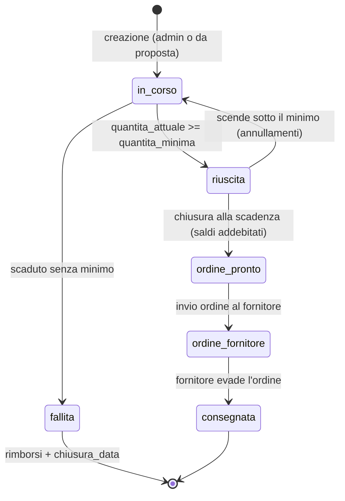
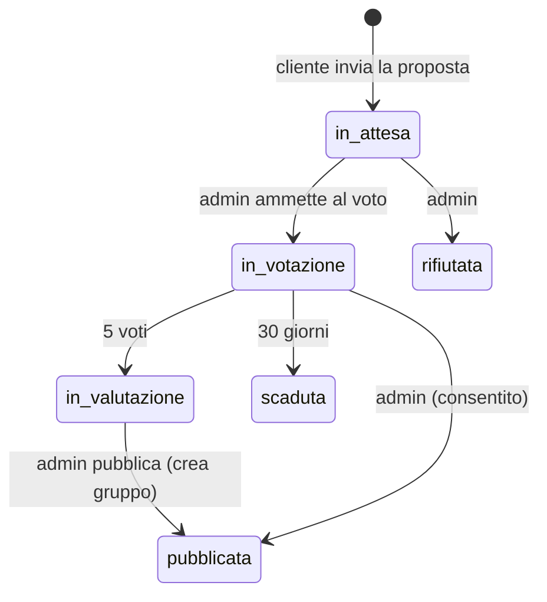

# 04 – Logica dei gruppi (ex "campagne")

## A cosa serve
Racconta il **ciclo di vita completo di un gruppo d'acquisto**: come nasce (da admin o da proposta), come si aderisce,
come cambia il prezzo con gli scaglioni, quando si può annullare, cosa succede alla scadenza e alla chiusura,
e come si arriva a "concluso" o "non attivato". Include le tabelle degli **stati** (gruppo e adesione) con chi li
provoca e le **incoerenze** tra campi che dicono cose diverse. Nei nomi interni: gruppo = `collette`/"campagna",
adesione = `prenotazioni`. `file:riga` riferiti al working tree attuale.

---

## 1. Vista d'insieme

Gli stati sono nella colonna `collette.stato` (ENUM: `in_corso`, `riuscita`, `fallita`, `ordine_pronto`, `ordine_fornitore`, `consegnata`, `annullata`). `annullata` è previsto dallo schema ma **nessun codice lo scrive**.

## 2. Creazione
### 2.1 Da admin – `POST /campagne` (`campagne_crea`, `campagne.php:622-741`)
- Solo admin. Scadenza obbligatoria e **futura** (`:630-632`).
- Due modi: su un `prodotto_id` esistente oppure creando prodotto+gruppo insieme (nome ≤ 80, fornitore, prezzo) – `:638-669`.
- Parametri: `quantita_minima` (MOQ, ≥ 1), `percentuale_commissione` (0–100, default **10**) – `:679-681`; `sede_id` (default: sede predefinita, `sede_predefinita_id`, `api/lib/sede.php`) – `:690`; scaglioni opzionali (max 10, soglie uniche, prezzi > 0, ordinati) – `valida_scaglioni` `:589-614`; foto opzionali.
- Scrive `prodotti` (se nuovo), `collette` (stato di default `in_corso`), `scaglioni_prezzo`, `immagini_prodotto`, in una transazione (rollback e cancellazione dei file in caso di errore, `:736-740`).

### 2.2 Da proposta – `PUT /proposte/{id}/stato` con `pubblicata` (`proposte.php:318-440`, `proposte_auto_crea` `:446-510`)
Solo admin. Crea **prodotto + gruppo + scaglioni** (copiati da `proposta_scaglioni`) e notifica proponente e votanti; poi invia a **tutti i clienti attivi** una notifica `ORDINE_DISPONIBILE` (`:422-431`). Valori di default: MOQ dalla proposta o 1; scadenza **+30 giorni**; commissione **10** (`:473-475`). Blocco di ripubblicazione: se esiste già un prodotto con `id_proposta_origine` = proposta → `GIA_PUBBLICATA` (`:375-382`). La sede predefinita è scritta anche qui (`:496`).

⚠ La categoria della proposta non viene copiata nel prodotto (`proposte.php:478`).

## 3. Prezzo e scaglioni
- Gli scaglioni sono coppie (soglia in **pezzi**, prezzo unitario) in `scaglioni_prezzo`, con UNIQUE `(id_colletta, soglia)`.
- Il **minimo del gruppo** è la soglia del primo scaglione se esistono scaglioni, altrimenti `quantita_minima` (`minimo_colletta`, `api/lib/stato.php:7-13`).
- Il **prezzo corrente** (quello che vale in quel momento) è quello dello scaglione più alto raggiunto dalla quantità totale (`prezzo_scaglione_raggiunto`, `api/lib/prezzi.php:51-58`); la barra di avanzamento mostra un solo traguardo alla volta (`obiettivo_barra`, `:81-98`).
- ⚠ `collette.prezzo_corrente` (colonna) **non si aggiorna da solo** con gli scaglioni: è scritto alla creazione e dalla modifica admin (`campagne.php:958`). I calcoli del saldo usano `prezzo_scaglione_raggiunto`, non la colonna (`pagamento.php:1198`, `campagne.php:407`); invece l'ordine al fornitore (`campagne.php:825`), il ritiro (`ritiro.php:124`) e le notifiche di `assegnazioni_ripartisci` (`assegnazioni.php:83`) usano la colonna → rischio di importi diversi (vedi 13).
- Gli scaglioni **non si possono modificare** se il gruppo ha già adesioni (`SCAGLIONI_BLOCCATI`, `campagne.php:988-995`).

## 4. Adesione
1. Il cliente apre il modale "Unisciti al gruppo" (`frontend/js/pages/dettaglio.js`), sceglie quantità (1–99) e ritiro/spedizione.
2. `POST /pagamento/acconto-checkout` valida tutto sul server e crea la Checkout Session (`pagamento.php:627-787`).
3. Dopo il pagamento, il **webhook** crea l'adesione (`webhook_acconto_crea`, `pagamento.php:793-899`): una sola per utente per gruppo (UNIQUE), stato iniziale `prenotata` oppure `confermata` se il minimo era già raggiunto (`stato_adesione_per_gruppo`, `api/lib/aumento.php:26-30`).
4. `quantita_attuale += quantità` e `ricalcola_stato`. Se il gruppo passa `in_corso → riuscita`, `gruppo_applica_minimo_raggiunto` conferma tutte le `prenotata` e notifica (`pagamento.php:886-888,905-936`).
5. Se il gruppo è già scaduto o chiuso quando arriva l'acconto → rimborso automatico (`:835-844`).

L'adesione diretta `POST /campagne/{id}/partecipazioni` è **disabilitata** (410).

## 5. Aumentare la quantità
`POST /pagamento/aumenta-checkout` → webhook `webhook_aumento_applica` (`pagamento.php:989-1175`). Consentito se (`aumento_errore`, `api/lib/aumento.php:37-58`): adesione `prenotata`/`confermata`; gruppo `in_corso`/`riuscita`; `chiusura_data` vuota; non scaduto; totale ≤ **99** pezzi. Si paga solo l'acconto dei pezzi aggiunti. Se la regola non vale più al momento del webhook → rimborso.

## 6. Annullamento da parte del cliente
`DELETE /campagne/{id}/partecipazioni` (`partecipazioni_ritira`, `partecipazioni.php:19-115`). Il **server** lo consente quando: il gruppo non è `ordine_fornitore`/`consegnata`, **non è scaduto**, e l'adesione non è `pagata`/`rimborsata`. Passi: rimborsa tutti gli acconti su Stripe (se fallisce, errore e nulla viene cancellato) → legge i dati per l'email → **`DELETE` della riga `prenotazioni`** → `quantita_attuale -= quantità` → `ricalcola_stato` → se si scende sotto il minimo le `confermata` tornano `prenotata` con notifica `SOGLIA_PERSA` (`:84-112`).

Cosa dice l'interfaccia: "Annulla adesione" solo se `puo_annullare`, calcolato dal server in `api/lib/acquisti.php:153` (`stato = 'prenotata'`, vista `in_corso`, non scaduto); a minimo raggiunto (`confermata`, vista `attivo`) il flag `annullo_bloccato` fa mostrare "l'adesione non si può più annullare" (`frontend/js/pages/acquisti.js:209-212`; lo dice anche l'email "minimo raggiunto", `notifiche_eventi.php:269`). **Ma l'endpoint `DELETE /campagne/{id}/partecipazioni` non applica questa regola**: accetta anche adesioni `confermata` fino alla scadenza (`partecipazioni.php:44-49`, e il ramo "flip-back" `:84-112` presuppone proprio questo caso). Chi chiama l'API direttamente può quindi annullare a minimo raggiunto. Vedi anomalie.

## 7. Raggiungimento del minimo
`ricalcola_stato` (`api/lib/stato.php:49-103`): in transazione con `SELECT … FOR UPDATE`, ricalcola **sempre da zero**: se `quantita_attuale >= quantita_minima` → `riuscita`; altrimenti se scaduto → `fallita`; altrimenti `in_corso`. Non tocca `ordine_pronto`, `ordine_fornitore` (si mantengono) né `consegnata`/`annullata` (terminali). Viene chiamata ovunque la quantità cambia e **anche in lettura** (`campagne_elenco`, `campagne_dettaglio`, `admin_ordini`).

⚠ Il minimo usato qui è la colonna `quantita_minima`, mentre l'interfaccia e la chiusura usano `minimo_colletta` (primo scaglione). Se le due non coincidono lo stato può divergere.

## 8. Scadenza e chiusura
### Chi la lancia, quando
`POST /campagne/chiusura?secret=…` (cron) oppure `POST /campagne/{id}/chiusura` (admin, UI `admin/campagne.js:99`) – `campagne_chiusura`, `campagne.php:273-316`. Il commento propone un cron **ogni ora** (`:270-271`); nel repository non esiste un cron installato (DA VERIFICARE sul server). Seleziona i gruppi con `data_limite <= NOW()`, `chiusura_data IS NULL` e stato non in `consegnata/annullata/ordine_pronto/ordine_fornitore` (`:297-301`).

### Cosa fa `chiusura_colletta` (`:323-502`)
| Esito | Condizione | Azioni |
|---|---|---|
| **Non attivato** | `ricalcola_stato` = `fallita`/`annullata`, oppure `quantita_attuale < minimo` (primo scaglione) | rimborso degli acconti (`chiusura_rimborsi`), adesioni → `rimborsata`, email+notifica `RIMBORSO`, `chiusura_data = NOW()` (stato resta `fallita`) |
| **Concluso** | minimo raggiunto | per ogni adesione `confermata`: saldo (`saldo_chiusura`) addebitato off_session; saldo ≤ 0 → solo `saldo_completa`; addebito riuscito → adesione `pagata` (+QR se ritiro); addebito fallito → `azione_richiesta` + 48 h (`saldo_scadenza`); poi `stato='ordine_pronto'`, `chiusura_data=NOW()` (`:500`) |

**Idempotenza:** lock `FOR UPDATE` sul gruppo, controllo di `chiusura_data` all'inizio (`:329-342`) e `UPDATE … WHERE chiusura_data IS NULL`. Il lock è però rilasciato prima degli addebiti Stripe (la transazione fa `commit` a `:344`), quindi due chiusure simultanee (cron + admin) non sono realmente escluse: vedi 13.

**Dopo la chiusura:** con tutte le adesioni `pagata` l'admin invia l'ordine al fornitore (`POST /campagne/{id}/invia-fornitore`, `invia_ordine_fornitore_al` `:800-884`); l'invio è **automatico** solo quando l'ultimo saldo in ritardo viene pagato (`saldo_completa` `pagamento.php:1265-1275`, webhook, `scripts/saldi_scaduti.php:82-90`). Poi il fornitore avanza l'ordine `inviato → ricevuto → in_preparazione → evaso` (`fornitori.php:526-577`) e il gruppo diventa `consegnata`, con email "Pronto per il ritiro". Il cliente ritira con QR (`POST /ritiro/{token}`, admin) o riceve la spedizione (`consegne_spedisci`).

### Quando viene scritta `collette.chiusura_data`
Solo in tre punti, **sempre dopo la scadenza**: `campagne.php:354` (gruppo fallito/annullato), `:402` (minimo non raggiunto), `:500` (chiusura riuscita). Non viene mai azzerata. Quindi se un admin sposta `data_limite` in avanti dopo la chiusura (`campagne_modifica` `:931-940`), si ottiene un gruppo con `chiusura_data` valorizzata e scadenza futura: è il caso dei dati demo osservati (gruppi 21, 31, 32, 33) e va considerato un **dato incoerente**, non uno stato valido. Per l'interfaccia (`stato_campagna_display`) un gruppo con scadenza futura è comunque "in corso".

## 9. Tabella degli stati

### 9.1 Gruppo (`collette.stato`)
| Valore DB | Significato | Transizione in ingresso | Chi/cosa la provoca (file:riga) |
|---|---|---|---|
| `in_corso` | aperto | creazione; ritorno da `riuscita` | `campagne.php:684`, `proposte.php:492`; `ricalcola_stato` `stato.php:85-87` |
| `riuscita` | minimo raggiunto, ancora aperto | da `in_corso` | `ricalcola_stato` `stato.php:81-82` |
| `fallita` | scaduto senza minimo | da `in_corso` | `ricalcola_stato` `stato.php:83-84` |
| `ordine_pronto` | chiuso, in attesa dei pagamenti/invio | da `riuscita`/`in_corso` | `chiusura_colletta` `campagne.php:500`; (legacy) `assegnazioni_ripartisci` `assegnazioni.php:77` |
| `ordine_fornitore` | ordine inviato al fornitore | da `ordine_pronto` | `invia_ordine_fornitore_al` `campagne.php:850` |
| `consegnata` | fornitore ha evaso | da `ordine_fornitore` | `fornitore_ordine_avanza` `fornitori.php:555` |
| `annullata` | – | **nessuno** | solo letto (`campagne.php:300,352`, `lib/acquisti.php:70`) |

### 9.2 Gruppo come lo vede l'interfaccia (calcolato, non salvato) – `stato_campagna_display` (`stato.php:23-34`)
| Valore | Regola | Etichetta sulla card (`frontend/js/stato-card.js:46-58`) |
|---|---|---|
| `in_corso` | scadenza non passata | "Aperto", "Gruppo attivo ✓" (minimo raggiunto) o "Hai aderito · N pezzi" |
| `in_chiusura` | scaduto, minimo raggiunto, `chiusura_data` vuota | "Concluso" (in attesa dell'addebito dei saldi) |
| `conclusa` | stato `ordine_pronto/ordine_fornitore/consegnata`, oppure scaduto+minimo+`chiusura_data` | "Concluso" |
| `non_riuscita` | stato `fallita/annullata`, oppure scaduto senza minimo | "Non attivato" |

### 9.3 Adesione (`prenotazioni.stato`)
| Valore | Significato | Chi lo scrive (file:riga) |
|---|---|---|
| `prenotata` | acconto pagato, minimo non ancora raggiunto | webhook acconto `pagamento.php:851`; flip-back `partecipazioni.php:97` |
| `confermata` | minimo raggiunto: sarà addebitato il saldo | `gruppo_applica_minimo_raggiunto` `pagamento.php:907`; webhook aumento `:1156`; nascita su gruppo già `riuscita` |
| `pagata` | saldo pagato | `saldo_completa` `pagamento.php:1244` |
| `azione_richiesta` | saldo non riuscito, 48 h per pagare | `segna_azione_richiesta` `campagne.php:543` |
| `rimborsata` | acconti rimborsati (gruppo fallito o saldo non pagato) | `chiusura_rimborsi` `campagne.php:529`; `scripts/saldi_scaduti.php:67` |
| `annullata` | – | **mai scritto**: l'annullamento cliente fa `DELETE` |

### 9.4 Come "I miei acquisti" classifica un'adesione (`acquisto_classifica`, `api/lib/acquisti.php:63-118`)
| Scheda | Vista (etichetta) | Quando |
|---|---|---|
| In corso | `in_corso` / `attivo` / `pagamento` | adesione `prenotata`/`confermata` (minimo non/già raggiunto) o `azione_richiesta` |
| In arrivo | `inviato` / `pronto` | adesione `pagata`; `pronto` solo con QR `generato`, ritiro in sede e gruppo `consegnata` |
| Conclusi | `ritirato` | QR `scansionato` o consegna `ritirata`/`consegnata` |
| Annullati | `rimborsato` / `annullato` | adesione `rimborsata`/`annullata`, o gruppo fallito (rimborso "in elaborazione") |

## 10. Incoerenze e stati duplicati
1. `stato` (gruppo) **e** `chiusura_data` esprimono entrambi "chiuso": `aumento_errore` e la chiusura guardano `chiusura_data`, la UI guarda `stato` + scadenza (`stato_campagna_display`). Modificare la scadenza dopo la chiusura li fa divergere.
2. Tre definizioni di "minimo": colonna `quantita_minima` (`ricalcola_stato`, `partecipazioni_ritira:52`, `normalizza_colletta:45`), primo scaglione (`minimo_colletta`, chiusura, UI), `prodotti.quantita_minima`.
3. `prezzo_corrente` (colonna) vs prezzo dello scaglione raggiunto (vedi §3).
4. `fallita` non è terminale per `ricalcola_stato`: se l'admin allunga la scadenza di un gruppo già rimborsato, il ricalcolo lo riporta `in_corso` con adesioni `rimborsata` (DA VERIFICARE con un test).
5. Il percorso legacy `assegnazioni_ripartisci` porta il gruppo a `ordine_pronto` **prima** dei pagamenti, mentre la chiusura moderna esclude i gruppi in `ordine_pronto` (`campagne.php:300`): usarlo su un gruppo aperto impedisce l'addebito automatico dei saldi (la UI lo chiama da `admin/ordini.js:8`).
6. Confronto di scadenza con operatori diversi: `<=` (`pagamento.php:643`), `<` (`partecipazioni.php:44`, `stato.php:29,77`), `<=` in `aumento_errore:51`.

## 11. Proposte: voti, soglia, scadenza

- **Creazione**: `proposte_crea` (`proposte.php:57-130`): solo clienti; nome 3–80, descrizione ≤ 300, link ≤ 500, categoria e prezzo indicativo opzionali, foto ≤ 5 MB; massimo **5 proposte attive** per utente, ricontrollato dentro una transazione con `FOR UPDATE` sull'utente (`:108-111`).
- **Voto**: `proposte_registra_voto` (`api/lib/proposte_regole.php:196-233`): solo clienti, CSRF obbligatorio, non si vota la propria proposta, non si vota una scaduta o non in votazione, un voto per utente (UNIQUE); conta i voti `favore`; a **5** → `in_valutazione` e notifica proponente e votanti. Il voto si può ritirare finché è in votazione (`:236-256`).
- **Scadenza**: dopo **30 giorni** (`PROPOSTE_GIORNI_VALIDITA`) una proposta in votazione è scaduta: calcolata al volo nelle query/`proposta_blocca` (`:263`) e resa permanente da `scripts/scadenza_proposte.php`.
- **Pubblicazione**: vedi §2.2. L'admin può pubblicare anche da `in_votazione` e da `approvata_admin` (legacy) – `proposte.php:369`.
- ⚠ `proposte_cambia_stato` non controlla le transizioni (es. si può riportare una proposta già `pubblicata` a `rifiutata`, pur esistendo il gruppo).

## Domande che potrebbero farmi
1. **Quali sono gli stati di un gruppo?** `in_corso → riuscita → ordine_pronto → ordine_fornitore → consegnata`, più `fallita`; `annullata` esiste ma non è usata (§9.1).
2. **Chi chiude un gruppo e quando?** Un cron/l'admin chiama `POST /campagne/chiusura` dopo la scadenza (`campagne.php:273`); se il minimo non è raggiunto rimborsa gli acconti, altrimenti addebita i saldi.
3. **Come evitate di chiudere due volte lo stesso gruppo?** `chiusura_data` + `FOR UPDATE` (`campagne.php:329-342`); il limite è che il lock non copre gli addebiti Stripe.
4. **Quando posso annullare l'adesione?** Fino alla scadenza e finché non è `pagata`; l'interfaccia lo vieta anche a minimo raggiunto, il server no.
5. **Come cambia il prezzo?** Con gli scaglioni: vale quello dell'ultimo scaglione raggiunto alla chiusura; il saldo si calcola su quel prezzo.
6. **Cos'è "non attivato"?** Gruppo scaduto senza minimo (stato interno `fallita`): si rimborsano gli acconti.
7. **Come si trasforma una proposta in gruppo?** A 5 voti passa in valutazione; l'admin la pubblica e `proposte_auto_crea` crea prodotto, gruppo (scadenza +30 giorni) e scaglioni.
8. **Perché `stato` e `chiusura_data`?** `stato` descrive il percorso, `chiusura_data` garantisce l'idempotenza della chiusura; la sovrapposizione crea le incoerenze del §10 (motivazione presunta: aggiunta dopo per rendere sicura la chiusura da cron).
