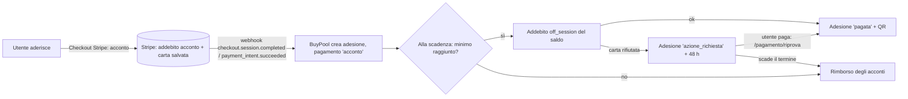

# 05 – Pagamenti (Stripe, acconto, saldo, rimborsi)

## A cosa serve
Questo documento spiega come BuyPool incassa i soldi: l'**acconto** al momento dell'adesione, il **saldo**
addebitato in automatico alla chiusura del gruppo, la **commissione**, la **spedizione** e i **rimborsi**.
Per ogni passaggio indica il file e la funzione dove avviene. Serve per spiegare a voce "dove vanno i soldi"
e per capire cosa può andare storto. Tutte le affermazioni vengono dal codice letto; dove non sono sicuro
c'è scritto **DA VERIFICARE**. I nomi interni dicono ancora *colletta* (= gruppo) e *prenotazione* (= adesione).

> Convenzioni: `file:riga` si riferisce al codice nello stato attuale del working tree (branch `feat/hero-layout`).
> Nessuna chiave Stripe è riportata: solo i NOMI delle variabili di configurazione.

---

## 1. Panoramica in una frase
BuyPool **non fa una preautorizzazione**: addebita subito l'acconto (un pagamento vero) e salva la carta
dell'utente su Stripe (`setup_future_usage: off_session`); alla chiusura del gruppo addebita il saldo con la
carta salvata, senza che l'utente sia presente (`off_session: true`). Se il gruppo non raggiunge il minimo, rimborsa gli acconti.



## 2. Configurazione coinvolta (solo nomi)
Letti da `api/config.php` (non versionato, `.gitignore`); modello in `api/config.example.php`.

| Variabile | A cosa serve | Dove è letta |
|---|---|---|
| `stripe_secret_key` | chiave segreta per le chiamate server → Stripe | `campagne.php:411,512`, `pagamento.php` (molte), `scripts/saldi_scaduti.php:29` |
| `stripe_publishable_key` | chiave pubblica per Stripe.js | `pagamento.php:606` (`pagamento_config`) |
| `stripe_webhook_secret` | verifica firma del webhook | `pagamento.php:130` |
| `acconto_percent` (esempio: 20) | percentuale dell'acconto | `pagamento.php:674`, `pagamento.php:1020`, `api/lib/acquisti.php:300` |
| `costo_spedizione` (esempio: 4,90) | costo della spedizione a domicilio | `api/lib/prezzi.php:41`, `pagamento.php:856` |
| `chiusura_secret` | segreto per chiamare la chiusura da cron | `campagne.php:276` |
| `frontend_url` | URL base per i redirect di Stripe e i link delle email | `pagamento.php:748,1019…`, `api/lib/mail.php:54` |

Nota: `chiusura_secret`, `frontend_url`, `stripe_*` risultano **usati ma assenti da `api/config.example.php`**
(che contiene solo `host, port, db, user, pass, google_client_id, acconto_percent, costo_spedizione, mail_*, smtp_*`
– `api/config.example.php:11-37`). Vedi anomalie (13).

## 3. Le formule (fonte unica: `api/lib/prezzi.php` e `api/lib/aumento.php`)

### 3.1 Acconto
`acconto = round( quantità × prezzo del PRIMO scaglione × acconto_percent / 100 , 2 )`, minimo **€0,50**.
- Codice: `api/endpoints/pagamento.php:685` (acconto iniziale), `:686` (minimo), `api/lib/aumento.php:14-17` (`acconto_aumento`, stessa formula per i pezzi aggiunti), costante `AUMENTO_ACCONTO_MINIMO = 0.50` in `aumento.php:11`.
- Il primo prezzo viene da `scaglioni_prezzo` (soglia più bassa) oppure, se non ci sono scaglioni, da `collette.prezzo_corrente` (`pagamento.php:675-684`, duplicato in `pagamento_primo_prezzo` `:972-981`).
- Arrotondamento: `round(..., 2)` PHP (mezzo verso l'alto), poi `(int)round($acconto*100)` in centesimi per Stripe (`pagamento.php:769`).

### 3.2 Saldo (UNICA formula: `saldo_dettaglio`, `api/lib/prezzi.php:17-28`)
```
merce       = round(quantità × prezzo_finale, 2)
commissione = round(merce × commissione% / 100, 2)      # % del GRUPPO, sul totale merce
spedizione  = round(max(0, spedizione), 2)               # solo se consegna a domicilio
totale      = round(merce + commissione + spedizione, 2)
saldo       = round(totale − acconto_versato, 2)         # può essere <= 0
```
- `prezzo_finale` = prezzo dello **scaglione più alto raggiunto** dal gruppo (`prezzo_scaglione_raggiunto`, `prezzi.php:51-58`).
- `saldo_chiusura` (`prezzi.php:31-34`) restituisce solo l'importo; `saldo_prenotazione` (`pagamento.php:1182-1201`) legge dal DB e chiama la formula.
- Chi usa la formula: chiusura (`campagne.php:419`), riprova/pagamento legacy (`pagamento.php:53,1305`), email di saldo (`notifiche_eventi.php:289`), stima (`notifiche_eventi.php:148`), lista acquisti (`api/lib/acquisti.php`), e lato browser `frontend/js/saldo-stima.js` (copia JS della stessa logica, vedi audit 12).
- **Stima per un gruppo ancora aperto** (`prezzo_per_stima_saldo`, `prezzi.php:65-72`): se il minimo è già raggiunto usa lo scaglione corrente, altrimenti il PRIMO scaglione.

### 3.3 Commissione BuyPool
- È una percentuale salvata **per gruppo**: colonna `collette.percentuale_commissione`. Default **10** alla creazione da admin (`campagne.php:679-680`) e da proposta (`proposte.php:475`).
- Si applica sul totale **merce** (non sul solo saldo) – `prezzi.php:20` e `pagamento.php:1203-1208`. Viene scritta in `pagamenti.commissione_agenzia` e `prenotazioni.importo_commissione` al momento del saldo (`pagamento.php:1227-1231,1244`).
- L'acconto registra `commissione_agenzia = 0` (`pagamento.php:865`).

### 3.4 Spedizione o ritiro
- Il cliente sceglie `ritiro_sede` o `consegna_domicilio` al momento dell'adesione (`pagamento_prepara_acconto`, `pagamento.php:631-671`). Con il ritiro la sede deve coincidere con quella del gruppo o con la sede predefinita (`api/lib/sede.php`).
- Il costo spedizione (config `costo_spedizione`) è salvato in `consegne.importo_consegna` quando nasce l'adesione (`pagamento.php:854-861`) ma **non è incluso nell'acconto**: entra nel saldo (`spedizione_per_modalita`, `prezzi.php:45-48`).
- Solo il ritiro in sede genera il **QR** (token casuale 48 caratteri hex) al momento del saldo (`pagamento.php:1236-1242`).

## 4. Flusso passo-passo

### 4.1 Acconto (adesione)
| # | Cosa succede | Dove |
|---|---|---|
| 1 | Il browser invia `POST /pagamento/acconto-checkout` (flusso principale) con gruppo, quantità, consegna | `pagamento_acconto_checkout`, `pagamento.php:740-787` (route in `api/index.php`) |
| 2 | Validazioni server: consegna valida, gruppo `in_corso/riuscita`, **non scaduto** (`data_limite <= NOW()` → `CAMPAGNA_SCADUTA`), utente non già iscritto, sede valida, acconto ≥ 0,50 | `pagamento_prepara_acconto`, `pagamento.php:627-693` |
| 3 | Si crea (o riusa) lo Stripe **Customer** dell'utente (`utenti.stripe_customer_id`) | `pagamento_customer`, `pagamento.php:610-621` |
| 4 | Checkout Session `mode: payment` con un solo articolo = acconto totale, `payment_intent_data.setup_future_usage = off_session`, metadata (`tipo=acconto`, `colletta_id`, `quantita`, `utente_id`, `delivery_type`, `id_sede`, `indirizzo`) | `pagamento.php:759-781` |
| 5 | Il browser va su Stripe (pagina ospitata); la carta non passa mai dal server | `pagamento.php:17-18` (commento), redirect `success_url` `:778` |
| 6 | Stripe chiama il **webhook** → `webhook_acconto_crea` crea **adesione** (`prenotazioni`), **consegna** (`consegne`), **pagamento** `acconto` (`pagamenti`), aggiorna `collette.quantita_attuale`, ricalcola lo stato | `pagamento.php:793-899` |
| 7 | Se il gruppo ha già il minimo l'adesione nasce `confermata`, altrimenti `prenotata` (`stato_adesione_per_gruppo`, `api/lib/aumento.php:26-30`) | `pagamento.php:851` |
| 8 | Notifica "Acconto addebitato" + email "Adesione confermata" (idempotente) | `pagamento.php:880-884`, `evento_adesione` `notifiche_eventi.php:204` |
| 9 | Se questa adesione porta il gruppo al minimo: tutte le `prenotata` → `confermata`, notifiche e email "minimo raggiunto" | `gruppo_applica_minimo_raggiunto`, `pagamento.php:905-936` |

Esiste anche `POST /pagamento/acconto-intent` (PaymentIntent + Stripe Payment Element, `pagamento.php:701-731`), descritto nel codice come "mantenuto come fallback" (`:699`). Il commento d'intestazione `:585-593` descrive ancora il Payment Element come flusso principale: **contraddizione tra commenti** (il codice di `acconto-checkout` dice di essere il principale, `:734`). DA VERIFICARE quale dei due usi il frontend: vedi la colonna "chiamato da" in `03-endpoint-api.md`.

### 4.2 Aumento della quantità
- `POST /pagamento/aumenta-checkout` (solo clienti; `pagamento_aumenta_checkout`, `pagamento.php:989-1063`). Regole in `aumento_errore` (`api/lib/aumento.php:37-58`): adesione `prenotata/confermata`, gruppo `in_corso/riuscita`, `chiusura_data` vuota, non scaduto, massimo **99 pezzi** totali.
- Acconto = solo dei pezzi aggiunti, stessa formula (`acconto_aumento`). Metadata `tipo=aumento` (non usa `prenotazione_id`, riservato al flusso legacy del saldo, `:987`).
- Webhook: `webhook_aumento_applica` (`pagamento.php:1070-1175`): incrementa `prenotazioni.quantita` e `importo_acconto`, aggiunge un nuovo record `pagamenti` (`acconto`), aggiorna il gruppo. Se nel frattempo l'aumento non è più valido → **rimborso automatico** del PaymentIntent (`:1125-1131`).
- Per questo un'adesione può avere **più pagamenti di acconto**: il rimborso li gestisce tutti (`rimborsa_acconti`).

### 4.3 Webhook (`POST /pagamento/webhook`, `pagamento_webhook`, `pagamento.php:116-384`)
- **Firma**: `\Stripe\Webhook::constructEvent` con `stripe_webhook_secret` (`:130`); manca firma → 400 (`:123-127`); firma/payload non validi → 400 (`:131-139`).
- **Eventi gestiti**: solo `checkout.session.completed` (`:167`) e `payment_intent.succeeded` (`:351`). Gli altri (es. `payment_intent.payment_failed`, `charge.refunded`, `charge.dispute.created`) **non sono gestiti**: vengono salvati in `eventi_stripe` ma restano non elaborati (nessuna riga di codice li marca; vedi anomalie).
- **Idempotenza a due livelli**:
  1. tabella `eventi_stripe` (`stripe_event_id` univoco): se l'evento è già `elaborato` risponde `duplicate` (`:144-152`);
  2. sul PaymentIntent: prima di creare l'adesione cerca `pagamenti.stripe_payment_intent_id` (`:814-820`, `:1096-1102`).
- **Errori**: in caso di eccezione fa rollback, rimette `elaborato = FALSE` e rilancia (`:893-898`) → Stripe riprova.
- **Due eventi per lo stesso pagamento**: con Checkout arrivano sia `checkout.session.completed` sia `payment_intent.succeeded`; entrambi finiscono in `webhook_acconto_crea`, che deve quindi essere idempotente (livello 2).
- **Self-healing**: `GET /pagamento/stato?session_id=…` (`pagamento_stato`, `:390-579`) – quando l'utente torna dal checkout, se Stripe dice "paid" e l'adesione non esiste ancora la crea subito con lo stesso codice (`:406-443`), usando un evento fittizio `sync_<session_id>`. Utile in locale senza `stripe listen`.

### 4.4 Chiusura e saldo automatico
- Chi la lancia: **cron/admin** `POST /campagne/chiusura?secret=…` (tutti i gruppi scaduti non chiusi) oppure `POST /campagne/{id}/chiusura` (uno solo, solo se scaduto, altrimenti `CHIUSURA_ANTICIPATA`) – `campagne_chiusura`, `campagne.php:273-316`. Accesso: admin in sessione oppure `hash_equals` del `chiusura_secret` (`:276-282`). Selezione: `data_limite <= NOW() AND chiusura_data IS NULL AND stato NOT IN (consegnata, annullata, ordine_pronto, ordine_fornitore)` (`:297-301`). Frequenza: il commento suggerisce "ogni ora" (`:270-271`); **nel repo non c'è un cron installato** (DA VERIFICARE sul server).
- `chiusura_colletta($cid)` (`campagne.php:323-502`):
  1. transazione con `FOR UPDATE` sul gruppo; se `chiusura_data` è già valorizzata esce (`gia_chiusa`) – `:329-342`;
  2. `ricalcola_stato`; se `fallita/annullata` → `chiusura_rimborsi` e `chiusura_data = NOW()` (`:352-356`);
  3. legge le adesioni `confermata` (con `FOR UPDATE`), gli scaglioni, e **ricontrolla il minimo** su `scaglioni[0].soglia` (`:398-404`): se non raggiunto → rimborsi + `chiusura_data`;
  4. prezzo finale = scaglione più alto raggiunto (`:407`); per ogni adesione calcola il saldo con `saldo_chiusura` (`:419`);
  5. **saldo ≤ 0**: nessun addebito, chiama `saldo_completa` con importo 0 (`:420-432`);
  6. altrimenti legge la carta salvata (`pagamenti.stripe_payment_method` dell'ultimo acconto + `utenti.stripe_customer_id`) – `:433-445`; se manca → `azione_richiesta` ("Metodo di pagamento mancante");
  7. **addebito**: `paymentIntents->create` con `off_session: true`, `confirm: true`, `allow_redirects: never` (`:454-468`);
  8. esito: `CardException` (es. `authentication_required`) o altro errore → `segna_azione_richiesta` (`:469-481`); `succeeded` → `saldo_completa` (`:482-492`); altro stato → `azione_richiesta`;
  9. alla fine: `UPDATE collette SET stato='ordine_pronto', chiusura_data=NOW()` (`:500`).
- `saldo_completa` (`pagamento.php:1214-1277`): in `FOR UPDATE` sulla adesione; idempotente (se già `pagata` non fa nulla); inserisce il pagamento `saldo`, il **QR** (solo ritiro in sede), imposta `pagata`, crea notifica e email "Saldo addebitato", ricalcola il gruppo e, se **tutte** le adesioni non rimborsate sono `pagata`, **invia l'ordine al fornitore** (`invia_ordine_fornitore_al`, `campagne.php:800-884`).
- Il webhook `payment_intent.succeeded` con `tipo=saldo` chiama la stessa `saldo_completa` (`pagamento.php:358-376`), quindi una conferma "doppia" (sincrona + webhook) è innocua.

### 4.5 Saldo non riuscito e riprova
1. `segna_azione_richiesta` (`campagne.php:540-555`): stato adesione `azione_richiesta`, `saldo_scadenza = NOW() + 48 ore` (`SALDO_TERMINE_ORE`, `notifiche_eventi.php:521`), notifica `PAGAMENTO_FALLITO` ed email "Pagamento del saldo non riuscito".
2. L'utente clicca "Aggiorna pagamento" → `POST /pagamento/riprova` (`pagamento_riprova`, `pagamento.php:1283-1340`): solo se `azione_richiesta`; ricalcola il saldo con la stessa formula; crea una Checkout Session del solo saldo (importo minimo €0,50) con metadata `tipo=saldo-retry` e salva `prenotazioni.importo_saldo`. **Attenzione**: `customer_email` e non `customer`, e senza `setup_future_usage` (`:1315-1333`).
3. Il `checkout.session.completed` con `prenotazione_id` ma senza `tipo=acconto/aumento` percorre il ramo "legacy" del webhook (`:189-347`) che chiude il pagamento del saldo (PAGAMENTO_RIUSCITO + email) e usa `commissione_prenotazione`.
4. `scripts/saldi_scaduti.php` (cron orario, solo CLI – `:13`): a 24 h dalla scadenza invia il **promemoria** (`evento_saldo_promemoria`, una sola volta grazie a `email_inviate`); a termine scaduto **rimborsa gli acconti**, imposta l'adesione `rimborsata`, toglie i pezzi dal gruppo (`GREATEST(0, quantita_attuale − quantità)`) ed emette l'email "Adesione annullata" (`:47-99`); se tutte le altre adesioni sono pagate, fa partire l'ordine al fornitore (`:82-90`).

### 4.6 Rimborsi
| Caso | Chi lo fa | Dove | Importo |
|---|---|---|---|
| Gruppo non raggiunge il minimo alla chiusura | `chiusura_rimborsi` | `campagne.php:508-537` | solo gli acconti (saldo mai addebitato) |
| Utente annulla l'adesione (prima della scadenza, prima del pagamento del saldo) | `partecipazioni_ritira` | `api/endpoints/partecipazioni.php:19-115` (rimborso `:55-65`) | tutti gli acconti dell'adesione |
| Saldo non pagato entro 48 h | `scripts/saldi_scaduti.php` | `:59` | tutti gli acconti |
| Adesione/acconto arrivato quando il gruppo è chiuso/scaduto o l'utente è già iscritto | webhook | `pagamento.php:835-844` | il PaymentIntent |
| Aumento non più valido | webhook | `pagamento.php:1125-1131` | il PaymentIntent |

- Tecnica: `$stripe->refunds->create(['payment_intent' => …], ['idempotency_key' => 'rimborso_'.$piId])` in `rimborsa_acconti` (`pagamento.php:943-969`); righe `pagamenti.stato = 'rimborsato'`. Se Stripe risponde "already been refunded" lo considera fatto (`:959`).
- **Non rimborsa il saldo**: se l'adesione è `pagata` l'annullamento è vietato (`PAGAMENTO_EFFETTUATO`, `partecipazioni.php:47-49`).
- Il rimborso è totale (nessun `amount`), quindi non si possono fare rimborsi parziali.
- La **data del rimborso non viene salvata** (solo `pagamenti.stato='rimborsato'`) – per questo il banner dell'interfaccia non mostra una data.

## 5. Esempio numerico completo (calcolato con le funzioni reali)
Valori d'esempio (inventati, ma con le regole del codice): prodotto con listino €30,00; scaglioni **10 pezzi → €25,00**, **15 pezzi → €22,00**;
commissione del gruppo **10 %**; `acconto_percent = 20`; spedizione **€4,90**. Calcolo eseguito con `api/lib/prezzi.php` e `api/lib/aumento.php`.

**Caso A – Anna aderisce con 3 pezzi, ritiro in sede; il gruppo chiude a 16 pezzi**
1. Acconto: `3 × 25,00 × 20 / 100 = €15,00` (primo scaglione, non il listino).
2. Alla chiusura il gruppo ha 16 pezzi ≥ 15 → prezzo finale **€22,00**.
3. `merce = 3 × 22 = 66,00`; `commissione = 66 × 10 % = 6,60`; `spedizione = 0`; `totale = 72,60`.
4. **Saldo = 72,60 − 15,00 = €57,60** (addebitato off_session).
5. Anna ha pagato in tutto 72,60. Rispetto al listino (3 × 30 = 90) ha risparmiato sulla merce 24,00.

**Caso B – stessa adesione con consegna a domicilio:** `totale = 66,00 + 6,60 + 4,90 = 77,50`; **saldo = 62,50**.

**Caso C – il gruppo chiude a 12 pezzi (solo primo scaglione):** prezzo finale €25,00; `merce = 75,00`, `commissione = 7,50`, `totale = 82,50`; **saldo = 67,50**.

**Caso D – Anna aumenta di 2 pezzi (da 3 a 5):** acconto aggiuntivo `2 × 25 × 20 / 100 = €10,00`; acconti totali €25,00. Chiusura a 16 pezzi: `merce = 110,00`, `commissione = 11,00`, `totale = 121,00`; **saldo = 96,00**.

**Caso E – il gruppo finisce a 8 pezzi (< 10):** nessun saldo; **rimborso di €15,00** (solo l'acconto) con `refunds->create`.

**Arrotondamenti** (3 pezzi a €16,99, commissione 7,5 %, spedizione 4,90): acconto `3 × 16,99 × 0,20 = 10,194 → 10,19`; `merce 50,97`; `commissione 3,82275 → 3,82`; `totale 59,69`; `saldo 49,50`. Ogni voce è arrotondata prima di sommarla, così le voci mostrate sommano esattamente all'addebito (`prezzi.php:12-13`).

## 6. Tabelle coinvolte e storico di un pagamento
| Tabella | Cosa contiene (per i pagamenti) |
|---|---|
| `pagamenti` | una riga per addebito: `tipo_pagamento` (`acconto`/`saldo`), `importo`, `commissione_agenzia`, `stripe_payment_intent_id`, `stripe_payment_method`, `stato` (`confermato`/`rimborsato`), `data_pagamento` |
| `prenotazioni` | adesione: `quantita`, `importo_acconto` (somma acconti), `importo_saldo`, `importo_commissione`, `stato`, `saldo_scadenza` |
| `consegne` | `modalita`, `id_sede`, `indirizzo_consegna`, `importo_consegna` |
| `eventi_stripe` | registro webhook: `stripe_event_id`, `tipo_evento`, `payload_json`, `elaborato`, `id_pagamento` |
| `qr_codes` | token del ritiro, creato al saldo |
| `utenti` | `stripe_customer_id` |
| `email_inviate` | registro e idempotenza delle email di evento |

**Come ricostruire lo storico di un'adesione:** `prenotazioni` (stato, importi) → `pagamenti` per `id_prenotazione` (acconti, aumenti, saldo, rimborsi) → `eventi_stripe.id_pagamento` (quale evento Stripe l'ha generato) → `email_inviate`/`notifiche` (cosa è stato comunicato). Tipi e colonne esatti sono in `02-database.md`.

## 7. Webhook doppi, in ritardo e concorrenza
- **Doppio webhook identico**: bloccato da `eventi_stripe.elaborato` (`pagamento.php:148`).
- **Due eventi diversi per lo stesso PaymentIntent** (Checkout + PI) o **webhook + redirect `pagamento_stato`**: controllati da `SELECT pagamenti WHERE stripe_payment_intent_id` dentro la transazione (`:814`), **senza lock** su quella riga. Se due richieste partono nello stesso istante possono entrambe superare il controllo, ma il database le ferma: `pagamenti.stripe_payment_intent_id` è UNIQUE e `prenotazioni(id_colletta,id_utente)` è UNIQUE (`02-database.md`, verificato su `information_schema`). La seconda transazione fallisce con errore di chiave duplicata → rollback, `eventi_stripe.elaborato` resta falso, la richiesta risponde 500 e **Stripe riprova** il webhook, che al secondo giro trova il pagamento e termina in silenzio. Quindi nessuna adesione doppia, ma un 500 transitorio nei log.
- **Webhook in ritardo**: l'adesione viene creata quando arriva; se nel frattempo il gruppo è scaduto o chiuso l'acconto viene rimborsato (`:835-844`).
- **Lock usati**: `FOR UPDATE` su `collette` in `ricalcola_stato` (`api/lib/stato.php:56-58`), su `prenotazioni` in `saldo_completa` (`pagamento.php:1219`) e nell'aumento (`:1111`); ordine dei lock "prima gruppo poi adesione" dichiarato (`:1068`).

## 8. Punti rischiosi (sintesi, dettagli in 13)
1. Chiusura senza chiave di idempotenza Stripe sul saldo (`campagne.php:454`) e nessun lock persistente tra chiusure concorrenti (cron + admin).
2. `scripts/saldi_scaduti.php`: rimborsa su Stripe **prima** di verificare che l'adesione sia ancora `azione_richiesta` (`:59-73`): se l'utente paga nel frattempo, l'acconto è rimborsato ma l'adesione risulta pagata (il codice lo segnala solo con un log).
3. Eventi Stripe non gestiti: `payment_intent.payment_failed`, `charge.refunded`, dispute.
4. Il saldo ≤ 0 (acconto maggiore del totale) non genera alcun rimborso della differenza (`campagne.php:420-432`).
5. `invia_ordine_fornitore_al` calcola `importo_totale = pezzi × collette.prezzo_corrente` (`campagne.php:825`), ma `prezzo_corrente` non si aggiorna con gli scaglioni (solo la modifica admin lo cambia, `campagne.php:958`): l'importo dell'ordine al fornitore può non coincidere con il prezzo finale usato per il saldo.

## 9. Wallet e credito
Non esiste un credito prepagato: `GET /wallet` e `/wallet/movimenti` (`api/endpoints/pagamenti.php:17-52`) mostrano solo lo **storico** dei pagamenti dell'utente (ultimi 50). `POST /wallet/ricarica` è dichiarato "placeholder" nel commento (`pagamenti.php:8`); DA VERIFICARE se la rotta esiste in `api/index.php`.

## Domande che potrebbero farmi
1. **Fate una preautorizzazione sulla carta?** No: l'acconto è un addebito reale e la carta è salvata (`setup_future_usage=off_session`, `pagamento.php:775`); il saldo è un secondo addebito `off_session` alla chiusura (`campagne.php:454-468`). Motivazione presunta: i gruppi durano settimane e le preautorizzazioni scadono in pochi giorni.
2. **Come si calcola il saldo?** `merce + commissione + spedizione − acconto`, con ogni voce arrotondata al centesimo (`prezzi.php:17-28`); il prezzo è quello dello scaglione più alto raggiunto.
3. **Su cosa si applica la commissione?** Sul totale merce, con la percentuale del singolo gruppo (default 10); non sul solo saldo.
4. **Cosa succede se la carta viene rifiutata al saldo?** L'adesione passa a `azione_richiesta` con 48 ore di tempo; l'utente può pagare con "Aggiorna pagamento"; allo scadere parte il rimborso dell'acconto e l'adesione è annullata (`saldi_scaduti.php`).
5. **Come evitate di creare due volte la stessa adesione se il webhook arriva due volte?** `eventi_stripe` blocca lo stesso evento; il controllo sul PaymentIntent in `pagamenti` blocca eventi diversi dello stesso pagamento; in caso di richieste simultanee intervengono i vincoli UNIQUE del database (§7).
6. **Come si rimborsa?** Rimborso totale del PaymentIntent con chiave di idempotenza `rimborso_<id>`; solo gli acconti (il saldo non si rimborsa perché dopo il saldo non si può annullare).
7. **Dove vanno i soldi?** Restano sul conto Stripe di BuyPool: nel codice non c'è Stripe Connect né trasferimenti ai fornitori (commento in `pagamento.php:595-598`).
8. **Perché l'acconto è calcolato sul primo scaglione?** È il prezzo più alto del gruppo: l'acconto è sempre ≤ del totale finale (motivazione presunta, non documentata).
