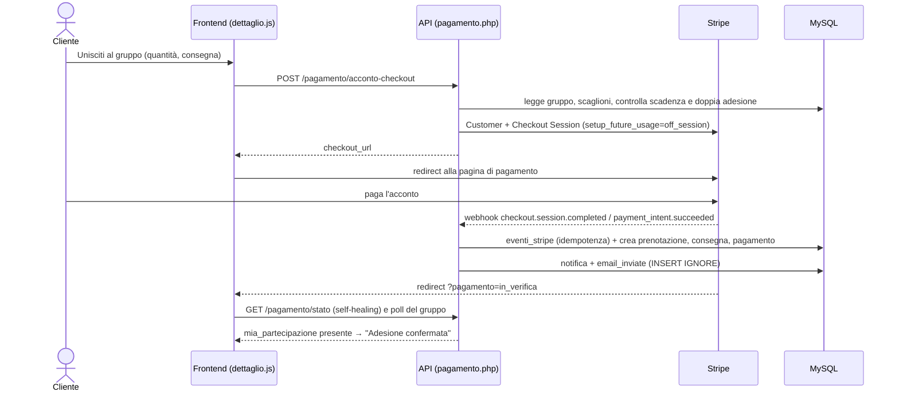
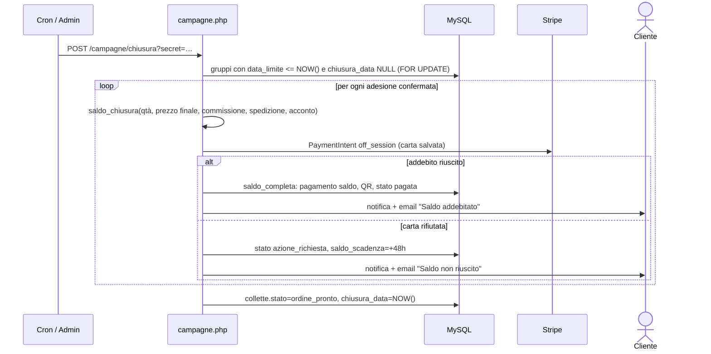
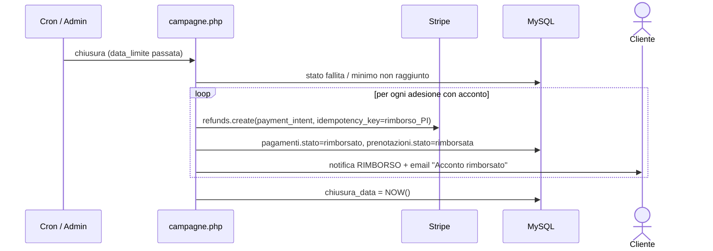

# 11 – Percorsi utente (dall'interfaccia al database)

## A cosa serve
Otto percorsi completi, passo per passo, che attraversano **interfaccia → endpoint → logica → database →
pagamenti/email**. Ogni passo ha il riferimento `file:riga`. Servono per "raccontare" il sistema a voce seguendo
un utente vero. Per (b), (d) ed (e) c'è anche un diagramma di sequenza. Gli esempi numerici sono in `05-pagamenti.md`.

---

## (a) Visitatore: registrazione e accesso
| # | Passo | Dove |
|---|---|---|
| 1 | Il visitatore apre `index.html#/register` e compila nome, email, password (≥ 8), tipo privato/b2b, consenso privacy | `frontend/js/pages/register.js:72-90` |
| 2 | `POST /registrazione`: valida email, lunghezza password, `privacy`; `password_hash`; `INSERT utenti` con `privacy_accettata_at = NOW()`; duplicato → `EMAIL_GIA_USATA` 409 (codice SQLSTATE 23000) | `api/endpoints/auth.php:6-39` |
| 3 | Il frontend salva la sessione locale (`localStorage`: utente + token finto) e va alla pagina per ruolo (`landingPerRuolo`) | `frontend/js/auth.js:26-31,46` |
| 4 | ⚠ Il server **non** ha creato la sessione PHP (`auth.php:38`): la prima chiamata autenticata dà 401 e riporta al login (DA VERIFICARE, `13-anomalie` C21) | `api.js:30-38` |
| 5 | Login: `POST /login` → `password_verify`, `session_regenerate_id(true)`, `$_SESSION['utente_id'/'ruolo']` | `auth.php:41-61` |
| 6 | Alternative: Google (`POST /auth/google`, token verificato con la libreria Google) e Microsoft (token **non verificato**, 13-A1) | `auth.php:63-182` |
| 7 | Il router `app.html` controlla la sessione (`GET /io` al ritorno sulla scheda) e mostra le pagine per ruolo | `app.html:121-216` |

## (b) Cliente aderisce a un gruppo e paga l'acconto
| # | Passo | Dove |
|---|---|---|
| 1 | Dalla home (`GET /campagne`) apre un gruppo → `GET /campagne/{id}` | `home.js:858`, `dettaglio.js:976` |
| 2 | Clicca "Unisciti al gruppo": se ospite, l'adesione viene tenuta in `sessionStorage` e si va al login | `dettaglio.js:592,988` |
| 3 | Modale di adesione: quantità (1–99) e consegna. "Ritiro in sede" è sempre disponibile e preselezionato, "Spedizione" attivabile (richiede via/CAP/città) | `consegna-metodi.js:11`, `dettaglio.js` (`#prenota-modal`) |
| 4 | "Continua su Stripe" → `POST /pagamento/acconto-checkout` | `dettaglio.js:848` |
| 5 | Il server valida: consegna, gruppo `in_corso/riuscita` e non scaduto, utente non già iscritto, sede valida (quella del gruppo o la predefinita), acconto ≥ 0,50 | `pagamento.php:627-693` |
| 6 | Calcolo acconto `round(qtà × prezzo primo scaglione × 20 % , 2)` | `pagamento.php:685` |
| 7 | Crea/riusa lo Stripe Customer e una Checkout Session `mode=payment` con `setup_future_usage=off_session` e metadata | `pagamento.php:610-621,759-781` |
| 8 | Il browser va su Stripe e paga; ritorna a `#/campagne/{id}?pagamento=in_verifica&session_id=…` | `pagamento.php:778` |
| 9 | Mentre aspetta, il frontend fa polling (`GET /pagamento/stato`, poi `GET /campagne/{id}`) fino a quando compare `mia_partecipazione` | `dettaglio.js:905-935` |
| 10 | Stripe invia il webhook (firma verificata); `webhook_acconto_crea` crea `prenotazioni`, `consegne`, `pagamenti(acconto)`, aggiorna `quantita_attuale` e lo stato | `pagamento.php:116-184,793-899` |
| 11 | Notifica "Acconto addebitato" + email "Adesione confermata" (idempotente) | `pagamento.php:880-884`, `notifiche_eventi.php:204` |
| 12 | Se il gruppo raggiunge il minimo: adesioni `prenotata→confermata`, notifiche e email "minimo raggiunto" | `pagamento.php:886-888,905-936` |

## (c) Aumentare la quantità
| # | Passo | Dove |
|---|---|---|
| 1 | In "I miei acquisti" o nel dettaglio: "Aumenta la quantità" (modale con stima dell'acconto aggiuntivo) | `components/aumenta-dialog.js:14-78` |
| 2 | `POST /pagamento/aumenta-checkout {prenotazione_id, quantita_aggiuntiva}`: controlli di `aumento_errore` (stato adesione, gruppo aperto, non chiuso, non scaduto, ≤ 99) | `pagamento.php:989-1017`, `api/lib/aumento.php:37-58` |
| 3 | Acconto aggiuntivo `k × primo prezzo × 20 %`; Checkout Session con metadata `tipo=aumento` | `pagamento.php:1020-1057` |
| 4 | Webhook → `webhook_aumento_applica`: `prenotazioni.quantita += k`, `importo_acconto += importo`, nuova riga `pagamenti(acconto)`, `quantita_attuale += k`; se non più valido → rimborso | `pagamento.php:1070-1175` |
| 5 | Notifica "Quantità aumentata" + email; se scatta un nuovo scaglione, notifica "Il prezzo è sceso" | `pagamento.php:1160-1165` |

## (d) Il gruppo raggiunge il minimo e si chiude con saldo
| # | Passo | Dove |
|---|---|---|
| 1 | Una adesione/aumento fa passare `quantita_attuale` sopra il minimo → `ricalcola_stato` = `riuscita`; le `prenotata` diventano `confermata`; notifiche/email | `stato.php:81-82`, `pagamento.php:905-936` |
| 2 | Il gruppo resta aperto fino a `data_limite`; il prezzo può ancora scendere | `04-logica-gruppi.md` §3 |
| 3 | Alla scadenza il cron (o l'admin) chiama `POST /campagne/chiusura` | `campagne.php:273-316`, UI `admin/campagne.js:99` |
| 4 | `chiusura_colletta`: lock sul gruppo, verifica minimo (primo scaglione), prezzo finale = scaglione più alto raggiunto | `campagne.php:323-407` |
| 5 | Per ogni adesione `confermata`: `saldo = merce + commissione + spedizione − acconto` | `campagne.php:419`, `prezzi.php:17-28` |
| 6 | Addebito `off_session` con la carta salvata (`payment_method` dell'ultimo acconto) | `campagne.php:433-468` |
| 7 | Riuscito → `saldo_completa`: pagamento `saldo`, QR (solo ritiro), adesione `pagata`, notifica + email "Saldo addebitato" | `pagamento.php:1214-1277` |
| 8 | Fallito → `segna_azione_richiesta`: `azione_richiesta`, `saldo_scadenza = +48 h`, notifica + email; l'utente paga con "Aggiorna pagamento" (`POST /pagamento/riprova`); dopo 24 h promemoria, dopo 48 h rimborso e annullamento (`scripts/saldi_scaduti.php`) | `campagne.php:540-555`, `pagamento.php:1283-1340`, `saldi_scaduti.php:47-99` |
| 9 | Fine: gruppo `ordine_pronto` + `chiusura_data`; con tutte le adesioni pagate l'admin invia l'ordine (`POST /campagne/{id}/invia-fornitore`) | `campagne.php:500`, `:800-884` |

## (e) Il gruppo non raggiunge il minimo: rimborso
| # | Passo | Dove |
|---|---|---|
| 1 | Alla scadenza `ricalcola_stato` dà `fallita` (o `quantita_attuale < primo scaglione`) | `stato.php:83-84`, `campagne.php:398-404` |
| 2 | Il cron chiama la chiusura; `chiusura_rimborsi` seleziona le adesioni `prenotata/confermata` con acconto > 0 | `campagne.php:352-356,508-537` |
| 3 | `rimborsa_acconti`: per ogni acconto `refunds->create` con `idempotency_key = rimborso_<PI>`; riga `pagamenti.stato='rimborsato'` | `pagamento.php:943-969` |
| 4 | Adesione → `rimborsata`; notifica `RIMBORSO` + email "Acconto rimborsato" (idempotente) | `campagne.php:529-530`, `notifiche_eventi.php:365-389` |
| 5 | `chiusura_data = NOW()`; l'interfaccia mostra "Non attivato" e, nel dettaglio, il banner "Il tuo acconto di €X è stato rimborsato." (senza data: la data del rimborso non è salvata) | `campagne.php:354`, `frontend/js/banner-fine.js` |
| 6 | Nessun saldo è mai addebitato; se un rimborso fallisce l'adesione resta com'è e si riprova alla chiusura successiva | `campagne.php:524-528` |

## (f) Ritiro con QR
| # | Passo | Dove |
|---|---|---|
| 1 | Al pagamento del saldo con ritiro in sede si crea il QR: token casuale in `qr_codes` (`generato`) | `pagamento.php:1236-1242` |
| 2 | Admin: ordine al fornitore (`invia_ordine_fornitore_al`) → fornitore avanza `inviato→ricevuto→in_preparazione→evaso`; all'ultimo passo il gruppo diventa `consegnata`, notifica `MERCE_PRONTA` ed email "Pronto per il ritiro" | `campagne.php:800-884`, `fornitori.php:525-577` |
| 3 | Il cliente vede "Pronto per il ritiro" in I miei acquisti (QR `generato`, ritiro in sede, gruppo `consegnata`) | `lib/acquisti.php:98-100` |
| 4 | "Mostra QR" → `GET /mie/assegnazioni/{id}/qr` e QR disegnato dal browser (libreria `qrcode.js`) | `qr-modal.js:7-49`, `ritiro.php:7` |
| 5 | Allo sportello l'admin scansiona/inserisce il token → `POST /ritiro/{token}`: transazione `FOR UPDATE`, QR → `scansionato`, notifica `RITIRATO` | `admin/ritiri.js:52`, `ritiro.php:75-159` |
| 6 | L'adesione appare in "Conclusi / Ritirato" e si può recensire | `lib/acquisti.php:93-97`, `recensioni.php:122-161` |
| 7 | Con la spedizione a domicilio non c'è QR: l'admin usa `POST /consegne/{id}/spedisci` e il cliente (UI assente) `conferma-ricezione` | `consegne.php:125-253` |

## (g) Proposta di un nuovo gruppo con voti
| # | Passo | Dove |
|---|---|---|
| 1 | Cliente: pagina Proposte → form (nome, descrizione, link, categoria, prezzo indicativo, foto ≤ 5 MB); "proposte simili" suggerite mentre scrive | `proposte.js:410,521`, `proposte.php:135-168` |
| 2 | `POST /proposte`: validazione, limite 5 attive (con lock), foto ricodificata; stato `in_attesa` | `proposte.php:57-130`, `lib/immagini.php` |
| 3 | L'admin la ammette al voto: `PUT /proposte/{id}/stato = in_votazione` (+ notifica al proponente) | `proposte.php:318-416` |
| 4 | Gli altri clienti votano (`POST /proposte/{id}/vota`, CSRF, un voto per utente, non la propria) | `proposte_regole.php:196-233` |
| 5 | A 5 voti: `in_valutazione`, notifica a proponente e votanti; dopo 30 giorni senza soglia: `scaduta` (cron) | `proposte_regole.php:146-149,213-222`, `scripts/scadenza_proposte.php` |
| 6 | L'admin pubblica (`pubblicata`, con prezzi, MOQ, scadenza, commissione, fornitore) → prodotto + gruppo + scaglioni + notifica a tutti | `proposte.php:405-432,446-510` |
| 7 | La proposta mostra il link al gruppo (`campagna_id`) | `proposte.php:12-27` |

## (h) L'admin apre un gruppo
| # | Passo | Dove |
|---|---|---|
| 1 | Admin → "Gruppi" → "Nuovo gruppo" (modale) con prodotto esistente o nuovo, prezzi, scaglioni, MOQ, scadenza, commissione, foto | `frontend/js/pages/admin/campagne.js:300-347` |
| 2 | `POST /campagne` (multipart) | `admin/campagne.js:347`, `campagne.php:622-741` |
| 3 | Validazioni: scadenza futura, fornitore esistente, prezzi > 0, MOQ ≥ 1, commissione 0–100, scaglioni (max 10, soglie uniche) | `campagne.php:630-681,589-614` |
| 4 | Transazione: `INSERT prodotti` (se nuovo), `INSERT collette` (con sede predefinita), `INSERT scaglioni_prezzo`, foto in `immagini_prodotto` | `campagne.php:657-731` |
| 5 | Il gruppo compare subito nella home (`GET /campagne`) con stato `in_corso` | `home.js:858` |
| 6 | Modifica successiva: scadenza, prezzi, commissione; scaglioni bloccati se ci sono adesioni | `campagne.php:893-1076` |

## Domande che potrebbero farmi
1. **Raccontami cosa succede quando clicco "Unisciti al gruppo".** Percorso (b): modale → checkout Stripe → webhook → adesione.
2. **Se chiudo il browser dopo aver pagato, l'adesione si crea?** Sì: la crea il webhook di Stripe (indipendente dal browser); in locale la crea anche `GET /pagamento/stato` quando l'utente ritorna.
3. **Quando viene addebitato il saldo?** Alla chiusura del gruppo, automaticamente, con la carta salvata (percorso (d)).
4. **E se la carta viene rifiutata?** 48 ore per aggiornare il pagamento; poi rimborso e adesione annullata.
5. **Cosa succede se il gruppo non raggiunge il minimo?** Nessun saldo; rimborso degli acconti ed email (percorso (e)).
6. **Come si ritira un ordine?** Con il QR generato al saldo, scansionato dall'admin; per la spedizione non c'è QR.
7. **Come nasce un gruppo da una proposta?** 5 voti → valutazione → pubblicazione dell'admin (percorso (g)).
8. **Cosa fa l'admin?** Crea e modifica gruppi, chiude (o lascia al cron), invia l'ordine al fornitore, conferma i ritiri, gestisce utenti, fornitori, proposte e notifiche.
