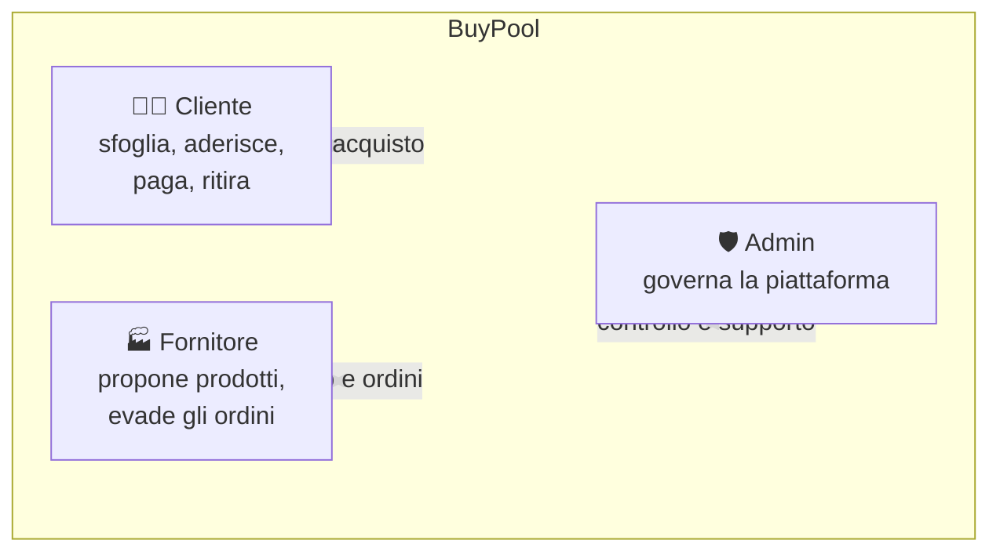
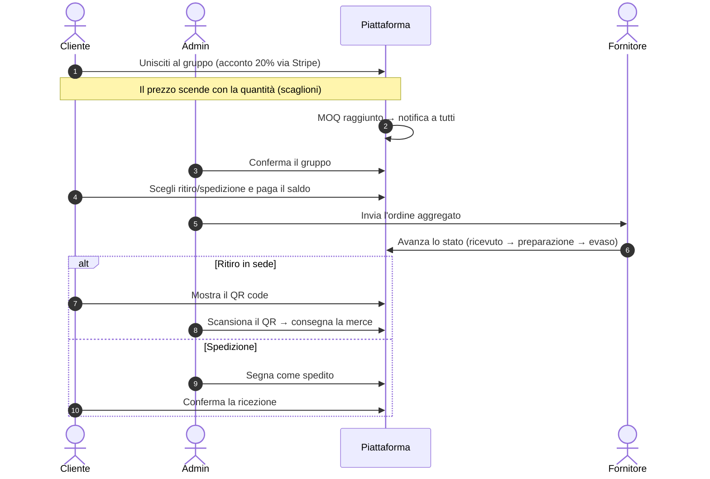

# BuyPool — Panoramica di prodotto

Documento divulgativo per stakeholder e commissione. Descrive cos'è BuyPool, quale problema risolve, come funziona e quali risultati raggiunge. Il dettaglio tecnico è in [`docs/tech/`](../tech/03-architettura.md).

## 1. Il problema

L'acquisto collettivo (group buying) permette a un gruppo di acquirenti di ottenere prezzi migliori acquistando insieme — ma nella pratica comporta caos: chat di gruppo, fogli Excel, incassi a mano, nessuna garanzia se il minimo non viene raggiunto, ritiri disordinati.

**BuyPool digitalizza l'intero ciclo**: proposta del prodotto → votazione pubblica → campagna di acquisto → pagamenti sicuri (Stripe) → ritiro in sede con QR code o spedizione → recensioni. Una piattaforma, tre attori, zero fogli Excel.

## 2. La soluzione

BuyPool è una web application di **group buying** con prezzi a scaglioni: più persone entrano nel gruppo, più scende il prezzo unitario. È costruita attorno a tre ruoli:

### Perché conviene a ciascun attore

| Attore | Beneficio |
|---|---|
| **Cliente** | Prezzi più bassi acquistando in gruppo, niente rischio se il gruppo fallisce (rimborso automatico dell'acconto), ritiro comodo o spedizione a casa |
| **Fornitore** | Domanda aggregata e prevedibile (vende in blocco al MOQ), nuovo canale di vendita senza investire in marketing |
| **Piattaforma** | Commissione percentuale su ogni campagna riuscita + dati di domanda reali dalle votazioni |

## 3. Come funziona — il ciclo di vita di un gruppo d'acquisto

Se il **minimo non viene raggiunto** entro la scadenza: il gruppo fallisce, gli acconti vengono **rimborsati automaticamente** — il cliente non rischia nulla.

## 4. Le funzioni distintive

| Funzione | Descrizione |
|---|---|
| **Prezzi a scaglioni** | Il prezzo unitario scende all'aumentare delle adesioni; tutti pagano il prezzo del livello raggiunto |
| **Acconto 20% + saldo** | Impegno economico minimo per entrare, saldo solo a gruppo confermato |
| **Votazione delle proposte** | Chiunque proponga un prodotto; la community vota; superata la soglia l'admin pubblica e la campagna nasce automaticamente |
| **Ritiro con QR code** | Ogni adesione confermata genera un QR univoco; il ritiro in sede è istantaneo e tracciato |
| **Spedizione opzionale** | Scegli tra ritiro gratuito in sede o consegna a domicilio con costo fisso |
| **Wallet e rimborsi** | Rimborsi automatici su Stripe con notifica; storico movimenti trasparente |
| **Notifiche ed email** | Centro notifiche in-app + email transazionali (mai duplicate, con retry) |
| **Recensioni** | Solo chi ha veramente acquistato può recensire fornitore e campagna |
| **Area fornitore self-service** | Il fornitore propone prodotti con foto e scaglioni, monitora le campagne, evado gli ordini in 3 passi |
| **GDPR** | Export dei propri dati e richiesta di cancellazione integrati nel profilo |

## 5. Stati di un gruppo (semplici per l'utente)

| Stato | Significato per il cliente |
|---|---|
| In corso | Il gruppo è aperto: unisciti, il prezzo scende |
| Riuscito / Ordine confermato | Il minimo è stato raggiunto: paga il saldo |
| Ordine al fornitore | Il gruppo ha ordinato: attendi la merce |
| Consegnata | Ritirata o ricevuta: puoi recensire |
| Fallita / Annullata | Non è andata: acconto rimborsato |

## 6. Stack tecnologico (sintesi)

- **Frontend**: web app moderna (HTML/CSS/JavaScript, nessun framework), accessibile da browser desktop e mobile.
- **Backend**: API REST in PHP 8.3 + MySQL.
- **Pagamenti**: Stripe (carte, checkout certificato, rimborsi automatici).
- **Login**: account tradizionale + Google (Microsoft in preparazione).
- **Email**: server SMTP dedicato in sviluppo (Mailpit), provider transazionale in produzione.
- **Sicurezza**: sessioni protette, upload immagini sanificati, webhook Stripe firmati, diritti GDPR integrati.

## 7. Indicatori chiave del progetto

| Metrica | Valore |
|---|---|
| Endpoint API | 98 rotte REST |
| Tabelle database | 23 |
| Pagine / schermate | 12 cliente + 4 sezioni fornitore + 8 admin |
| Test automatici | 22 suite (PHP + Node) |
| Ruoli | 3 (cliente, fornitore, admin) |
| Integrazioni esterne | Stripe, Google, Microsoft (in preparazione), SMTP |

## 8. Roadmap suggerita (post-progetto)

1. App mobile / PWA per notifiche push e scansione QR integrata.
2. Attivazione Microsoft OAuth (completamento verifica JWT).
3. Coupon e programmi fedeltà sul wallet.
4. Multi-sede con geolocalizzazione delle sedi di ritiro.
5. Dashboard analytics per fornitori (conversioni per scaglione).

---

Per il funzionamento passo-passo vedi [02-manuale-operativo.md](02-manuale-operativo.md) · Per la presentazione in slide: [`docs/presentazione/`](../presentazione/index.html)
