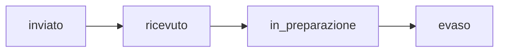

# Manuale operativo — BuyPool

Manuale d'uso per ruolo: **cliente**, **fornitore**, **amministratore**. Ogni sezione è un passo-passo autoconsistente.

## 0. Accesso alla piattaforma

1. Aprire l'app nel browser (dev: `http://localhost:8888/buypool/frontend/index.html`).
2. **Registrarsi** (nome, cognome, email, password ≥8 caratteri, accettazione privacy) oppure accedere con **Google**.
3. Dopo il login atterri sulla home **Gruppi d'acquisto**.

Recupero password: dalla schermata di login → *Password dimenticata* → inserisci l'email → il link di reset arriva via email.

---

## 1. Cliente

### 1.1 Unirsi a un gruppo d'acquisto

1. Dalla home, scegli un gruppo (filtri per ricerca, categoria, fornitore, stato).
2. Nel dettaglio, leggi prezzo corrente, scaglioni e countdown.
3. Scegli la **quantità** → **Partecipa**.
4. Vieni reindirizzato su **Stripe** per pagare l'**acconto (20%)**.
5. Al ritorno, la tua adesione è **"In Attesa"**: il prezzo scende man mano che altri si uniscono.

> Se il gruppo non raggiunge il minimo (MOQ) entro la scadenza: **fallisce e l'acconto viene rimborsato automaticamente**.

### 1.2 Pagare il saldo e ricevere la merce

1. Quando il gruppo raggiunge il minimo, l'admin lo conferma: la tua adesione diventa **"Da Pagare"** (notifica + email).
2. Apri **Acquisti** → gruppo → **Paga** (Stripe): saldo + eventuale spedizione.
3. Scegli la **consegna**:
   - **Ritiro in sede**: gratuito — generi il tuo **QR code**;
   - **Spedizione a domicilio**: costo fisso, attendi la spedizione.
4. **Ritiro**: mostra il QR all'addetto in sede. **Spedizione**: conferma la ricezione dalla pagina acquisto quando la merce arriva.
5. Dopo la consegna puoi **recensire** il gruppo (stelle 1–5 + testo).

### 1.3 Aumentare la quantità

Su un'adesione già attiva puoi **aumentare** i pezzi: paghi subito un acconto pezzi extra; il saldo finale si ricalcola automaticamente.

### 1.4 Ritirare l'adesione

In **Acquisti** → *Ritira adesione*: possibile finché il gruppo non è stato ordinato. Se scende il totale sotto il minimo, il gruppo torna in discussione (gli altri vengono notificati).

### 1.5 Proporre un prodotto

Sezione **Proposte** → *Nuova proposta*:

1. Compila nome, descrizione, categoria, prezzi e scaglioni; allega una **foto** (max 5 MB, JPG/PNG/WEBP).
2. L'admin la esamina: se approvata entra in **votazione pubblica**.
3. La community vota (soglia: 5 voti favorevoli); raggiunta la soglia e pubblicata dall'admin, **la campagna si crea automaticamente** e arriva una notifica a tutti.

Vincoli: massimo 5 proposte attive per utente; la votazione dura al massimo 30 giorni.

### 1.6 Altre funzioni

| Funzione | Dove |
|---|---|
| KPI e gruppi consigliati | Dashboard |
| Storico acquisti in 4 schede (in corso / in arrivo / conclusi / annullati) | Acquisti |
| Saldo e movimenti | Wallet |
| Notifiche (badge non lette in alto) | Notifiche |
| Modifica dati, password, **export GDPR**, richiesta cancellazione | Profilo |
| Recensire un fornitore | Dettaglio fornitore (solo dopo un acquisto pagato) |

---

## 2. Fornitore

### 2.1 Attivazione account

L'admin crea l'anagrafica e genera un **invito** (token valido 7 giorni, inviato via email). Il destinatario apre il link → si registra/logga → l'account diventa ruolo **fornitore**.

### 2.2 Proporre un prodotto

Area Fornitore → **Proposte** → form:

1. Nome, MOQ richiesto, prezzo base/corrente, **foto**, **scaglioni** (soglia + prezzo).
2. La proposta segue lo stesso ciclo di votazione/valutazione dell'admin.

### 2.3 Monitorare le campagne

Sezione **Gruppi**: elenco delle campagne attive sui propri prodotti con **percentuale di adesione** rispetto al minimo.

### 2.4 Evadere gli ordini (3 passi)

Sezione **Ordini**: per ogni ordine ricevuto, avanza lo stato con un clic:

Ogni avanzamento genera una notifica ai clienti coinvolti.

---

## 3. Amministratore

### 3.1 Dashboard

`#/admin`: KPI (utenti, campagne, pagamenti), quick link alle sezioni.

### 3.2 Gestire i gruppi (`#/admin/campagne`)

| Azione | Quando |
|---|---|
| **Crea campagna** | Nuova campagna manuale (nome, fornitore, prezzi, scaglioni, immagini, MOQ, scadenza) |
| **Modifica / elimina** | Correzioni o cancellazione |
| **Conferma** | Il gruppo ha raggiunto il MOQ → le adesioni passano a "Da Pagare", si generano i QR |
| **Invia al fornitore** | Tutti hanno pagato → ordine al fornitore (`Ordine al Fornitore`) |
| **Chiusura** | Automatica a scadenza (cron) o manuale: calcola esito, rimborsi se fallita |

### 3.3 Proposte (`#/admin/proposte`)

- **Ammetti** in votazione · **Pubblica** (auto-crea prodotto + campagna + broadcast) · **Rifiuta** (con motivo, notificato al proponente).

### 3.4 Utenti (`#/admin/utenti`)

Attiva/sospendi, cambia ruolo, visualizza storico acquisti, elimina (GDPR).

### 3.5 Fornitori (`#/admin/fornitori`)

Crea/anagrafica fornitori, **genera inviti** (token 7 giorni), collega utenti esistenti all'anagrafica.

### 3.6 Ordini e consegne (`#/admin/ordini`)

Ordini al fornitore e **spedizioni**: quando la merce parte → *Segna spedito* (con tracking).

### 3.7 Ritiri (`#/admin/ritiri`)

Ritiro fisico: **scannerizza il QR** del cliente (o inserisci il token) → conferma → la merce è consegnata. Un token può essere usato **una sola volta**.

### 3.8 Notifiche (`#/admin/notifiche`)

Invia notifiche a un singolo utente o **broadcast** a tutti.

### 3.9 Reset password per un utente

Utenti → utente → **genera link di reset** → inoltra il link all'utente (flusso admin-assisted).

---

## 4. Tavola degli stati

### Gruppo (campagna)

| Stato | Cosa significa |
|---|---|
| In corso | Aperto alle adesioni |
| Il gruppo raggiunge il minimo | MOQ raggiunto, in attesa conferma admin |
| Fallita | Scaduto senza MOQ → rimborsi |
| Ordine confermato | Pagamenti completati, in preparazione ordine |
| Ordine al Fornitore | Ordine inviato al fornitore |
| Consegnata | Merce consegnata/ritirata |
| Annullata | Annullato dall'admin |

### Adesione (prenotazione)

| Stato | Cosa significa |
|---|---|
| In Attesa | Acconto pagato, gruppo in corso |
| Da Pagare | Gruppo confermato: paga il saldo |
| Pagata | Tutto saldato |
| Azione richiesta | Saldo non riuscito: hai 48 ore per riprovare |
| Annullata | Adesione terminata (rimborso acconto) |
| Rimborsata | Acconto rimborsato su Stripe |

---

## 5. FAQ

**Quanto pago per entrare in un gruppo?** Solo l'acconto (20% del prezzo del primo scaglione). Il saldo solo a gruppo confermato.

**E se il gruppo fallisce?** Rimborsi automatico dell'acconto su Stripe (5–10 giorni lavorativi a seconda della banca).

**Posso uscire dopo aver pagato l'acconto?** Sì, finché il gruppo non è stato ordinato al fornitore.

**Quanto costa la spedizione?** Costo fisso configurato dalla piattaforma; il ritiro in sede è sempre gratuito.

**Come faccio a diventare fornitore?** Solo su invito dell'admin.

**I miei dati di pagamento sono al sicuro?** I pagamenti passano direttamente su Stripe (certificato PCI); la piattaforma non vede né memorizza i dati della carta.

**Come esporto o cancello i miei dati?** Profilo → *Export dati* (JSON) / *Richiesta cancellazione* (GDPR).

---

Documentazione collegata: [01-panoramica-prodotto.md](01-panoramica-prodotto.md) · [05-api-reference.md](../tech/05-api-reference.md)
