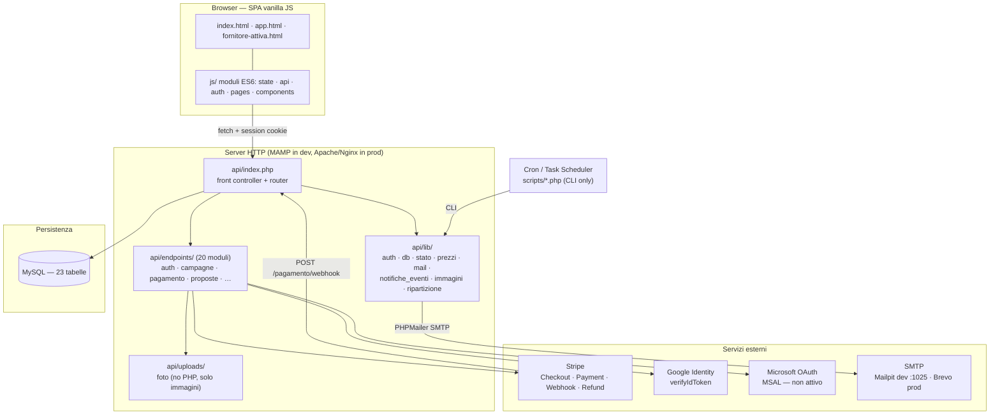
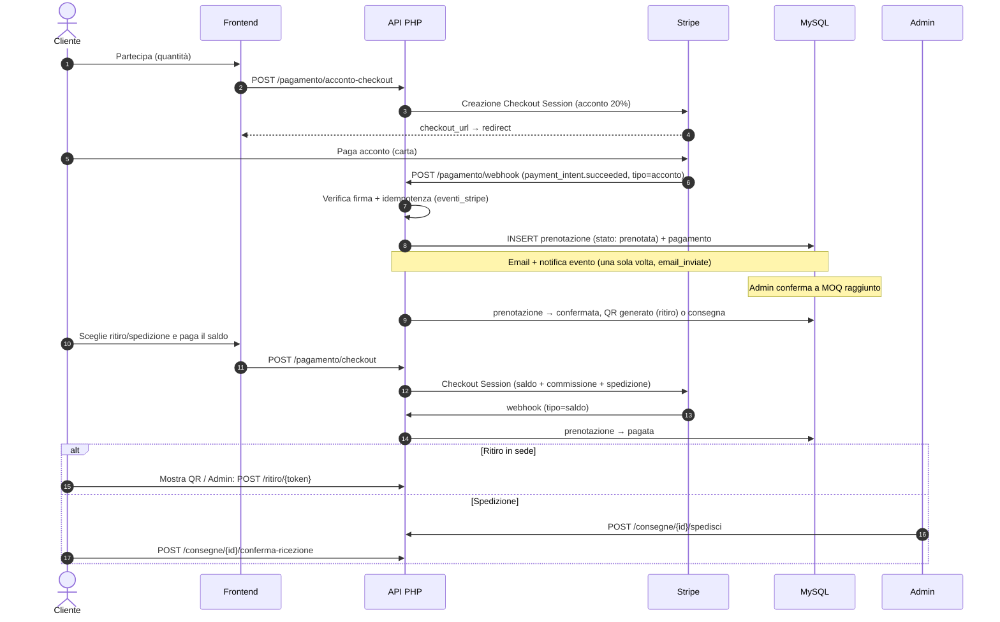
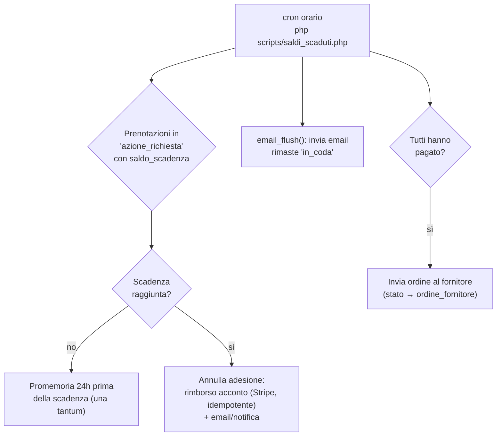

# Architettura di sistema — BuyPool

Documento tecnico di riferimento sull'architettura della piattaforma BuyPool.
Destinatari: commissione d'esame, sviluppatori.

## 1. Panoramica dello stack

BuyPool è una piattaforma di **group buying** (acquisto collettivo) con architettura **a due livelli** comunicanti via API REST:

| Livello | Tecnologia | Ruolo |
|---|---|---|
| Frontend | HTML5 + CSS3 + JavaScript ES6 (vanilla, nessun framework/build) | SPA con routing hash, render client-side, chiamate `fetch` all'API |
| Backend | PHP 8.3 (front controller unico) | API REST, logica di business, integrazioni (Stripe, OAuth, SMTP) |
| Database | MySQL / MariaDB (utf8mb4, InnoDB) | 23 tabelle, FK con CASCADE/SET NULL |
| Esterni | Stripe, Google Identity, Microsoft Entra ID, SMTP (Mailpit in dev) | Pagamenti, login, email |

Caratteristiche: **nessun framework** lato server (router custom in `api/index.php`), **nessun bundler** lato client (`<script type="module">` nativi), sessioni PHP lato server (il "token" del localStorage è solo un flag client-side).

## 2. Diagramma dei componenti



## 3. Frontend

SPA con **routing basato su hash** (`#/…`), definito in `frontend/app.html` (`routes[]` con guard `auth`/`admin`) e in `index.html` per le pagine guest (login, register, password dimenticata, privacy, attivazione fornitore).

- **Stato globale**: `js/state.js` (`state = {user, token, isLoading}`), persistito in `localStorage` (`buypool_token`, `buypool_user`); sottoscrizione con `subscribe(handleRoute)` → re-render a ogni cambio.
- **Client HTTP**: `js/api.js` — `apiGet/Post/Put/Delete` + `apiPostForm` (multipart per upload); header `Authorization: Bearer <flag>`; handling 401 → clear session + redirect.
- **Auth client**: `js/auth.js` — login/register tradizionali + Google GSI + Microsoft MSAL (popup).
- **Pagamenti**: nessuno SDK Stripe lato client — redirect a Checkout Session (`window.location.href = checkout_url`), esito su `#/pagamento/successo|annullato`.
- **QR code**: generazione client-side (`js/lib/qrcode.js`) del token restituito da `GET /mie/assegnazioni/{id}/qr`.

Dettagli in [`Frontend-Guide.md`](../../Frontend-Guide.md).

## 4. Backend

**Front controller unico** `api/index.php`:

1. `session_start()` (cookie `httponly`, `SameSite=Lax`), timezone `Europe/Rome` (le date DB sono wall-clock locali);
2. `require` di tutte le librerie e degli endpoint;
3. tabella `$rotte` = `[metodo, schema, handler]` (98 rotte + webhook Stripe in bypass);
4. matching path con parametri tipizzati (`{id}` solo cifre, `{token}` alfanumerico);
5. error handling unificato: `AppError` (codice/HTTP/campi) → `json_errore`; errori PHP mai esposti (`display_errors=0`), solo `error_log`.

**Convention di risposta** (`lib/risposta.php`): successo `json_ok($dati, $http)` → `{"dati": …}` (o payload diretto); errore `json_errore($codice, $messaggio, $http, $campi?)` → `{"errore": {"codice", "messaggio", "campi"?}}`.

**Librerie core** (`api/lib/`):

| Libreria | Responsabilità |
|---|---|
| `db.php` | Singleton PDO (`EMULATE_PREPARES=false`) |
| `auth.php` | Sessione utente, ruoli (`richiedi_login/utente_attivo/cliente/fornitore`), CSRF |
| `stato.php` | Calcolo stati campagna/adesione |
| `prezzi.php` | Formule pure: saldo di chiusura, prezzo scaglione, stime |
| `aumento.php` | Regole "aumenta quantità" (acconto pezzi extra, tetto 99) |
| `ripartizione.php` | Ripartizione pezzi (metodo dei resti), funzione pura |
| `acquisti.php` | Classificazione "I miei acquisti" (4 schede) |
| `consigliati.php` | Ranking deterministico "gruppi consigliati" |
| `proposte_regole.php` | Soglia 5 voti, 30 giorni, max 5 proposte attive |
| `immagini.php` | Upload sicuro: riscrittura totale via GD, EXIF strip, resize, WebP |
| `mail.php` | Invio email SMTP unico (`invia_email`, best-effort), PHPMailer vendored |
| `notifiche_eventi.php` | Registro eventi email/notifiche **idempotente** (`email_inviate`) |

## 5. Flussi sequenziali principali

### 5.1 Pagamento: acconto → raggiungimento MOQ → saldo → consegna



### 5.2 Proposta prodotto → votazione → auto-creazione campagna

```mermaid
sequenceDiagram
    autonumber
    actor F as Fornitore/Cliente
    actor A as Admin
    participant DB as MySQL

    F->>DB: POST /proposte (multipart: foto, scaglioni) — stato: in_attesa
    A->>DB: PUT /proposte/{id}/stato → in_votazione
    loop Max 30 giorni, max 5 voti per utente (CSRF richiesto)
        F->>DB: POST /proposte/{id}/vota (favore/contrario)
    end
    A->>DB: PUT /proposte/{id}/stato → pubblicata
    DB->>DB: auto: INSERT prodotto + colletta + scaglioni + immagini
    DB->>DB: notifica broadcast a tutti gli utenti
    Note over DB: Se voti &lt; soglia o scadenza: respinta_votazione / scaduta
```

### 5.3 Ritiro fisico con QR code

```mermaid
sequenceDiagram
    autonumber
    actor U as Cliente
    actor Adm as Admin (sede)
    participant API as API PHP
    participant DB as MySQL

    U->>API: GET /mie/assegnazioni/{id}/qr
    API->>DB: SELECT/INSERT qr_codes (token 64 hex, stato: generato)
    API-->>U: SVG QR client-side (js/lib/qrcode.js)
    U->>Adm: Mostra QR in sede
    Adm->>API: POST /ritiro/{token}
    API->>DB: UPDATE qr_codes → scansionato; prenotazione/ordine → ritirato
    API-->>Adm: Esito scansione (token già usato → errore)
```

### 5.4 Chiusura campagne, saldo scaduto e retry email (cron)



Script collegati: `scadenza_proposte.php` (ogni ora: proposte >30gg → `scaduta`), `pulisci_foto_proposte.php` (giornaliero: file orfani in `uploads/`, dry-run di default). Tutti **CLI-only** (`PHP_SAPI !== 'cli'` → 403) e **idempotenti**.

## 6. Modello di auth e ruoli

- **Sessione PHP** lato server (cookie `httponly` + `SameSite=Lax`); `session_regenerate_id(true)` al login.
- **Ruoli**: `cliente`, `fornitore`, `admin` (`utenti.ruolo`); guardie: `richiedi_login` (401), `richiedi_utente_attivo` (blocca sospesi, 403 `UTENTE_SOSPESO`), `richiedi_cliente` (403 `SOLO_CLIENTI`), `richiedi_fornitore` (403 + anagrafica `fornitori.id_utente` collegata), `sono_admin` (403 `NON_ADMIN`).
- **CSRF**: token di sessione confrontato con header `X-CSRF-Token` (`hash_equals`); attualmente applicato alle sole operazioni di voto proposte.
- **OAuth**: Google (`verifyIdToken`) e Microsoft (JWT — *placeholder, firma non verificata*: vedi [06-sicurezza-gdpr.md](06-sicurezza-gdpr.md)).

## 7. Scelte progettuali e compromessi

| Scelta | Motivazione | Compromesso |
|---|---|---|
| Nessun framework (PHP + router custom) | Controllo totale, zero dipendenze di scaffolding | Router e validazioni manuali; meno "gratuità" (migration runner, ORM) |
| Vanilla JS, no bundler | Zero build step, deploy = copia file | Nessun tree-shaking/TS; stile inline nei template |
| Webhook Stripe come fonte di verità dei pagamenti | Idempotenza reale, resistenza a redirect persi | Richiede endpoint pubblico raggiungibile + cron self-healing (`pagamento_stato`) |
| Eventi email idempotenti (`email_inviate`) | Mai email duplicate, retry senza perdita | Tabella di coda da monitorare (runbook) |
| Upload immagini riscritti via GD | Elimina metadati e payload nascosti | Perdita EXIF; CPU sul resize |
| Sessioni PHP (non JWT) | Stato revocabile immediato (sospensione utenti) | Scale-out orizzontale più delicato (sessioni su disco/DB) |

## 8. Punti di estensione noti

- **Microsoft OAuth**: da completare (verifica JWT con `firebase/php-jwt`, già in vendor).
- **CSRF globale**: estendere `richiedi_csrf()` a tutte le scritture mutative.
- **Config 12-factor**: oggi tutto in `api/config.php` (vedi [09-guida-deploy.md](../ops/09-guida-deploy.md)).
- **CI**: test standalone già presenti (`tests/`), manca un runner unico (composer script o pipeline).

Documentazione collegata: [04-modello-dati.md](04-modello-dati.md) · [05-api-reference.md](05-api-reference.md) · [07-integrazioni-esterne.md](07-integrazioni-esterne.md)
