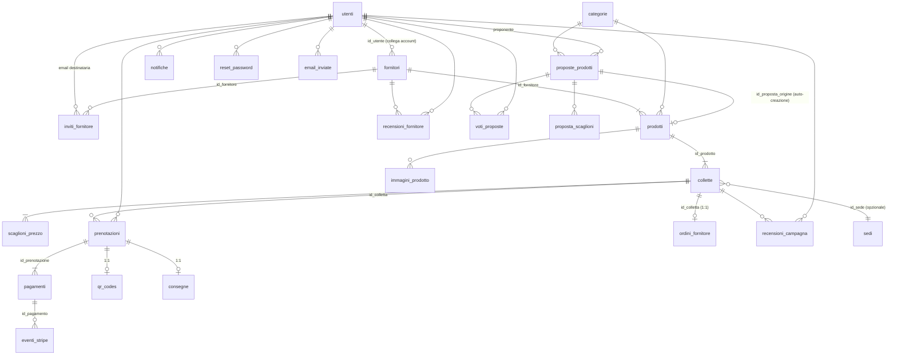
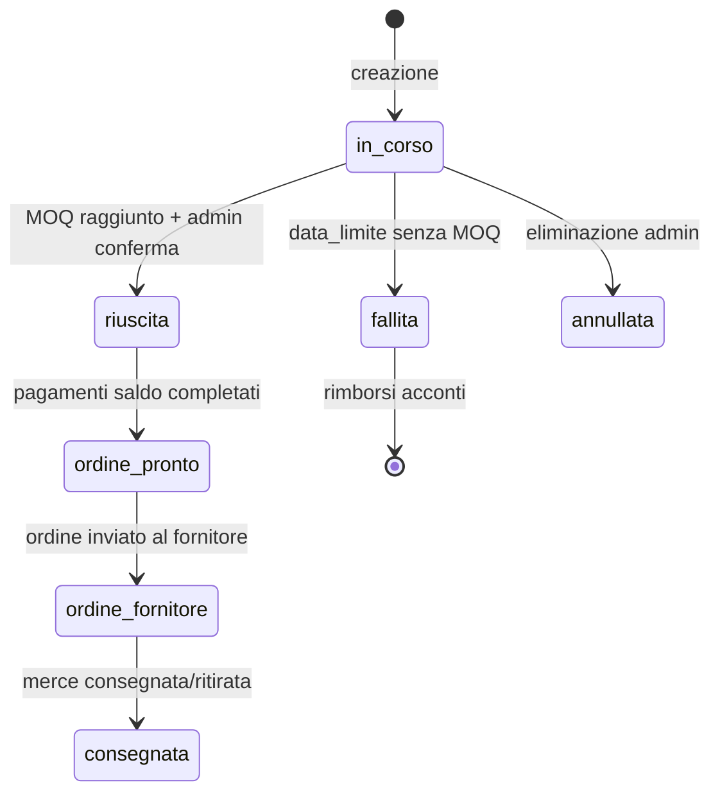
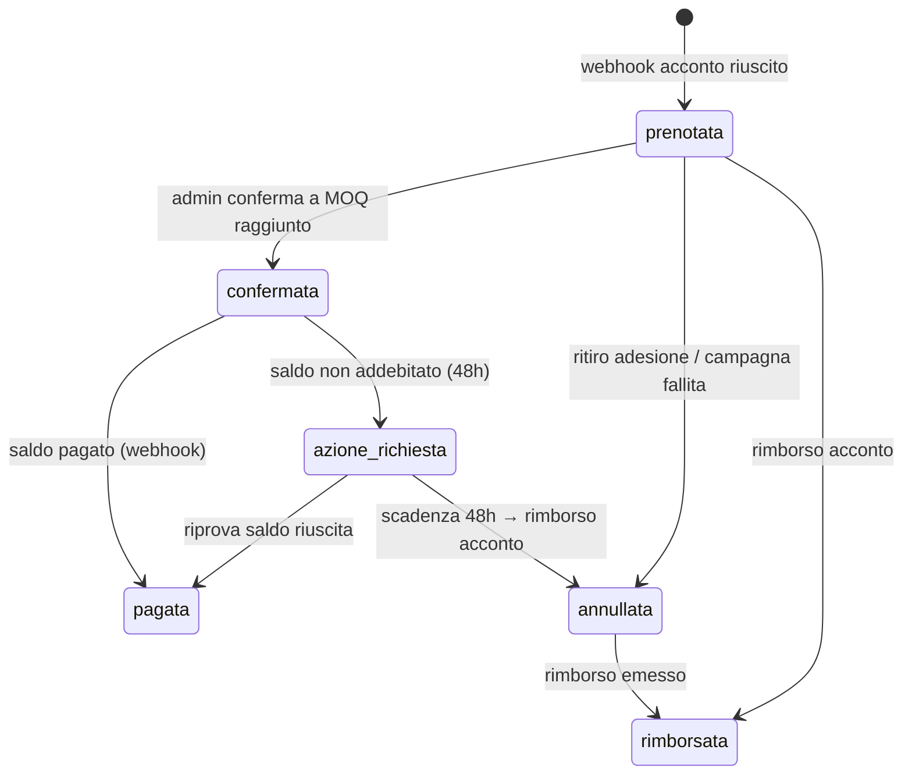

# Modello dati — BuyPool

Schema database di produzione: **23 tabelle** (MySQL/InnoDB, `utf8mb4_unicode_ci`). Fonte di verità: [`api/schema.sql`](../../api/schema.sql). Migrazioni incrementali in [`api/migrations/`](../../api/migrations/).

## 1. Diagramma Entità-Relazione

## 2. Tabelle

### 2.1 Identità e anagrafiche

| Tabella | Scopo | Note chiave |
|---|---|---|
| **utenti** | Account (cliente / fornitore / admin) | `email` unica; `password_hash` nullable (solo OAuth); `google_id`/`microsoft_id` unici; `stripe_customer_id`; `ruolo` ENUM; `stato` attivo/sospeso; `privacy_accettata_at` |
| **fornitori** | Anagrafica fornitori (catalogo pubblico) | Collegata a un utente via `id_utente` (UNIQUE, SET NULL); `partner_pubblico`, logo, P.IVA, categoria |
| **inviti_fornitore** | Inviti single-use per attivare un account fornitore | `token` unico, `scadenza` (7 giorni), `usato`; CASCADE sul fornitore |
| **categorie** | Classificazione prodotti | Seed da `seed_data.sql` |
| **sedi** | Punti di ritiro fisico | Indirizzo, città, orari |

### 2.2 Proposte e catalogo

| Tabella | Scopo | Note chiave |
|---|---|---|
| **proposte_prodotti** | Proposte di prodotto (cliente/fornitore/admin) | `stato`: `in_attesa → in_votazione → (approvata_admin → pubblicata) / rifiutata / respinta_votazione / scaduta`; `tot_voti`; limiti: max 5 attive, 30 giorni di votazione; `foto_file` (upload GD), `motivo` (rifiuto) |
| **voti_proposte** | Voti `favore`/`contrario` | UNIQUE (proposta, utente) — un voto per utente |
| **proposta_scaglioni** | Prezzi a scaglioni della proposta | `soglia` + `prezzo`; copiati in `scaglioni_prezzo` alla pubblicazione |
| **prodotti** | Catalogo prodotti | Nasce da campagna admin o auto dalla proposta (`id_proposta_origine`); `quantita_minima` = MOQ |
| **immagini_prodotto** | Galleria immagini prodotto | `principale`, `ordine` |

### 2.3 Campagne (collette) e adesioni

| Tabella | Scopo | Note chiave |
|---|---|---|
| **collette** | Campagna di acquisto collettivo | `quantita_minima` (MOQ) vs `quantita_attuale`; `data_limite`; `stato` (7 valori, vedi §3); `prezzo_base/corrente`; `percentuale_commissione` (default 10%); `regola_arrotondamento` difetto/eccesso; UNIQUE implicito su attive per prodotto gestito a livello applicativo |
| **scaglioni_prezzo** | Prezzi unitari per soglia di partecipanti | UNIQUE (colletta, soglia); il prezzo effettivo scende all'aumentare della quantità |
| **prenotazioni** | Adesioni di un utente a una colletta | **UNIQUE (colletta, utente)** — una sola adesione per utente/campagna; `quantita`; `importo_acconto/saldo/commissione`; `stato` (6 valori, vedi §3); `saldo_scadenza` (48h per ri-pagamento) |

### 2.4 Pagamenti e ritiro

| Tabella | Scopo | Note chiave |
|---|---|---|
| **pagamenti** | Transazioni Stripe | `tipo_pagamento`: acconto/saldo/consegna; `stripe_payment_intent_id` UNIQUE; `stato`: in_attesa/confermato/fallito/rimborsato; `commissione_agenzia` |
| **eventi_stripe** | Registro webhook per **idempotenza** | `stripe_event_id` UNIQUE; `payload_json`; `elaborato` |
| **qr_codes** | Token di ritiro in sede | `token` 64 hex UNIQUE; `quantita_assegnata`; `stato`: generato/scansionato/annullato |
| **consegne** | Modalità di consegna della prenotazione | 1:1 con prenotazione; `ritiro_sede` (gratis) o `consegna_domicilio` (costo); `stato`: in_attesa/pronta/spedita/consegnata/ritirata |
| **ordini_fornitore** | Ordine aggregato al fornitore | **1:1 con colletta** (`id_colletta` UNIQUE); `stato`: da_negoziare → inviato → ricevuto → in_preparazione → evaso → consegnato / annullato |

### 2.5 Comunicazioni

| Tabella | Scopo | Note chiave |
|---|---|---|
| **notifiche** | Avvisi in-app (centro notifiche) | `tipo` ENUM (18 valori: SCADENZA, PAGAMENTO_RIUSCITO, MOQ_RAGGIUNTO, NUOVO_SCAGLIONE…); `tipo_riferimento` + `id_riferimento`; `letta` |
| **email_inviate** | Registro eventi email **idempotente** + coda | **UNIQUE (evento, riferimento_tipo, riferimento_id, id_utente)** — un'email per evento; `stato`: in_coda/inviata/solo_notifica/scartata; `tentativi`; retry via cron |
| **reset_password** | Link monouso di reset | `token` unico, `scadenza`, `usato` |

## 3. Macchine a stati

### 3.1 Campagna (`collette.stato`)

Label UI (`frontend/js/constants.js`): `in_corso` "In Corso", `riuscita` "Il gruppo raggiunge il minimo", `fallita` "Fallita", `ordine_pronto` "Ordine Confermato", `ordine_fornitore` "Ordine al Fornitore", `consegnata` "Consegnata", `annullata` "Annullata".

### 3.2 Adesione (`prenotazioni.stato`)

Label UI: `prenotata` "In Attesa", `confermata` "Da Pagare", `pagata` "Pagata", `annullata` "Annullata", `rimborsata` "Rimborsata", `azione_richiesta` "Azione richiesta".

### 3.3 Ordine fornitore (`ordini_fornitore.stato`)

`da_negoziare → inviato → ricevuto → in_preparazione → evaso → consegnato` (+ `annullato`).
I passi `inviato→ricevuto→in_preparazione→evaso` sono avanzati dal fornitore con `POST /fornitore/ordini/{id}/avanza` (transizioni consentite codificate in `fornitori.php`).

### 3.4 Proposta (`proposte_prodotti.stato`)

`in_attesa → in_votazione → (approvata_admin → pubblicata)`; terminali: `rifiutata` (admin, con `motivo`), `respinta_votazione` (soglia non raggiunta), `scaduta` (>30 giorni, cron `scadenza_proposte.php`).

## 4. Indici

`utenti(ruolo)` · `collette(stato, data_limite)` · `prenotazioni(id_colletta)` · `prodotti(id_fornitore)` · `prodotti(id_categoria)` · `proposte_prodotti(stato)` · `proposte_prodotti(stato, data_proposta)` · `proposte_prodotti(proponente_id, stato)` · `pagamenti(stripe_payment_intent_id)` · `eventi_stripe(tipo_evento)` · `notifiche(id_utente, letta)` + UNIQUE applicativi citati sopra.

## 5. Migrazioni

Non esiste un migration runner: le migrazioni si applicano **manualmente** (phpMyAdmin o `mysql` CLI), in ordine cronologico, eseguendo prima `*_up` (il file senza suffisso `_down`) e conservando il `_down` come rollback.

| File | Contenuto |
|---|---|
| `2026-10-19_proposte_votazione.sql` | Stati e meccanica votazione proposte |
| `2026-10-20_proposte_form_foto.sql` | Campi form proposta: categoria, prezzi, foto |
| `2026-10-21_email_notifiche.sql` | Tabella `email_inviate` + colonna `prenotazioni.saldo_scadenza` |

> Nota: `schema.sql` riflette già lo schema finale; le migrazioni servono per aggiornare DB creati prima dell'introduzione delle rispettive funzionalità.

Documentazione collegata: [03-architettura.md](03-architettura.md) · [05-api-reference.md](05-api-reference.md) · [09-guida-deploy.md](../ops/09-guida-deploy.md)
