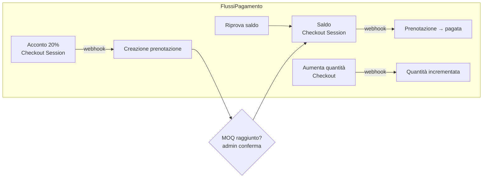

# Integrazioni esterne — BuyPool

Panoramica completa dei servizi esterni integrati: configurazione, flusso, ambenti (sviluppo/produzione) e checklist di setup.

## 1. Stripe — pagamenti

### 1.1 Configurazione (`api/config.php`)

| Chiave | Ambiente dev | Ambiente prod |
|---|---|---|
| `stripe_secret_key` | `sk_test_…` | `sk_live_…` |
| `stripe_publishable_key` | `pk_test_…` | `pk_live_…` |
| `stripe_webhook_secret` | `whsec_…` (dashboard test) | `whsec_…` (dashboard live) |
| `frontend_url` | `http://localhost:8888/…` | `https://dominio/…` |

### 1.2 Flussi implementati



- **Acconto**: Checkout Session (`POST /pagamento/acconto-checkout`) — il webhook `payment_intent.succeeded` con metadata `tipo=acconto` **crea la prenotazione** (il client non la crea mai direttamente).
- **Saldo**: Checkout per prenotazioni `confermata` — importo = saldo di chiusura + commissione + eventuale spedizione.
- **Aumento**: checkout dedicato che incrementa la quantità della prenotazione.
- **Rimborsi**: `refunds->create` con idempotency key, invocati da chiusura campagne fallite e da `saldi_scaduti.php`.
- **Self-healing**: `GET /pagamento/stato` riesamina lo stato reale su Stripe se un webhook è andato perso.

### 1.3 Webhook

| Valore | Dev (Mailpit-style locale) | Prod |
|---|---|---|
| URL endpoint | `https://<tunnel>/api/pagamento/webhook` (Stripe non raggiunge localhost) | `https://dominio/api/pagamento/webhook` |
| Tool locale | Stripe CLI: `stripe listen --forward-to localhost:8888/buypool/api/pagamento/webhook` | — |
| Eventi | `payment_intent.succeeded`, `checkout.session.completed` | idem |

**Idempotenza**: ogni evento è registrato in `eventi_stripe` (UNIQUE su `stripe_event_id`) — le ripetute consegne di Stripe non producono effetti duplicati.

### 1.4 Ambiti
Chiavi **test** (`_test`) per sviluppo: carte di prova Stripe (es. `4242 4242 4242 4242`). Prima del go-live: chiavi **live** + webhook live + verifica dei primi pagamenti reali in microtransazione.

## 2. Google OAuth (Google Identity Services)

- **Frontend**: SDK GSI caricato in `index.html` (`https://accounts.google.com/gsi/client`); `client_id` in `frontend/js/pages/login.js`. Flujo: popup → `credential` (ID token JWT) → `POST /auth/google`.
- **Backend**: `Google\Client::verifyIdToken` con `google_client_id` di config; match su `google_id` oppure email; se assente, crea un nuovo utente `cliente`.
- **Setup Google Cloud Console**:
  1. crea/proietto OAuth;
  2. *Credentials → OAuth client ID → Web application*;
  3. Authorized JavaScript origins: dominio del frontend;
  4. copia il `client_id` in `login.js` e in `config.php`;
  5. (consigliato) restri il consenso ai domini interni.
- **Nota sicurezza**: in dev il client HTTP di Google è configurato con `verify => false` (rete MAMP/localhost con cert problematici) — **da rimuovere in produzione** ([06-sicurezza-gdpr.md](06-sicurezza-gdpr.md)).

## 3. Microsoft OAuth (MSAL) — non attivo

- **Frontend**: MSAL browser (`msal.min.js`), `clientId` **placeholder** (`YOUR_MICROSOFT_CLIENT_ID_HERE`) in `login.js`.
- **Backend**: `auth_microsoft_login` decodifica il JWT **senza verifica della firma** — implementazione dichiaratamente *placeholder*.
- **Stato**: login Microsoft **non utilizzabile** in produzione così com'è.
- **Per attivarlo**:
  1. Azure Portal → App registration → Client ID + Tenant;
  2. verifica JWT (firma, `iss`, `aud`, `exp`, nonce) con `firebase/php-jwt` (già nel vendor di Stripe SDK);
  3. inserire `microsoft_client_id` in `config.php` e il client ID in `login.js`.

## 4. Email transazionali — Mailpit (dev) e SMTP reale (prod)

### 4.1 Architettura

Tutte le email partono da **una sola funzione**: `invia_email()` (`api/lib/mail.php`, PHPMailer). I template sono HTML con layout comune (logo BuyPool, footer).

```mermaid
flowchart LR
    EV[Evento applicativo<br/>pagamento · rimborso ·<br/>scadenza · invito · reset] --> REG["registra_evento_email()<br/>tabella email_inviate<br/>(idempotente)"]
    REG --> INV["invia_email() → SMTP"]
    ERR[Errore SMTP] -.->|in_coda + retry| CRON[cron: saldi_scaduti.php<br/>(email_flush)]
    OK[inviata] --> LOG
    OK --> NOT[notifica in-app<br/>tabella notifiche]
```

- **Idempotenza**: chiave UNIQUE `(evento, riferimento_tipo, riferimento_id, id_utente)` — mai email duplicate per lo stesso evento.
- **Best-effort**: un errore SMTP **non blocca mai** pagamenti o rimborsi; l'email resta `in_coda` e viene ritentata dal cron orario (`email_flush`).

### 4.2 Mailpit (sviluppo)

Mailpit è un server SMTP di test locale che **non invia email reali**: cattura tutto e lo mostra su un'interfaccia web.

| Componente | Valore |
|---|---|
| Binary | `%LOCALAPPDATA%\mailpit\mailpit.exe` (o `brew install mailpit`) |
| SMTP | `127.0.0.1:1025` (no auth, no TLS) |
| Web UI | http://localhost:8025 |
| Config dev (`config.php`) | `mail_enabled=true`, `smtp_host=127.0.0.1`, `smtp_port=1025`, `smtp_auth=false`, `smtp_secure=''` |
| Test | `GET http://localhost:8888/buypool/api/_dev/mail-test` (solo da localhost) |

Avvio (Windows):

```powershell
Start-Process "$env:LOCALAPPDATA\mailpit\mailpit.exe" -WindowStyle Hidden `
  -ArgumentList '--smtp=127.0.0.1:1025','--listen=127.0.0.1:8025'
```

Ogni email (reset password, invito fornitore, notifiche pagamento) appare su http://localhost:8025 — fondamentale per testare i flussi senza account SMTP reali.

### 4.3 Produzione (es. Brevo)

| Chiave | Valore esempio |
|---|---|
| `mail_enabled` | `true` |
| `smtp_host` | `smtp-relay.brevo.com` |
| `smtp_port` | `587` |
| `smtp_auth` | `true` |
| `smtp_user` / `smtp_pass` | credenziali SMTP (API key Brevo) |
| `smtp_secure` | `tls` |
| `mail_from` | `noreply@dominio.tld` (dominio verificato) |

Prerequisiti: dominio con **SPF e DKIM** configurati presso il provider, altrimenti le email finiscono in spam. Provider alternativi equivalenti: AWS SES, Postmark, Mailgun.

## 5. QR code

- Generazione **client-side** (`frontend/js/lib/qrcode.js`) a partire dal token restituito da `GET /mie/assegnazioni/{id}/qr`.
- Il token (64 hex) è memorizzato in `qr_codes` con stato `generato → scansionato`; la scansione in sede è `POST /ritiro/{token}` (admin).
- Nessun servizio esterno: tutto interno all'applicazione.

## 6. Riepilogo variabili d'ambiente per servizio

| Servizio | Config backend | Config frontend | Note prod |
|---|---|---|---|
| Stripe | 3 chiavi + webhook secret | — (`frontend_url` in backend) | Chiavi live + webhook registrato |
| Google OAuth | `google_client_id` | `client_id` in `login.js` | TLS verify on |
| Microsoft OAuth | `microsoft_client_id` | `clientId` in `login.js` | Completare verifica JWT |
| SMTP | blocco `mail_*`/`smtp_*` | — | SPF/DKIM, `mail_enabled=true` |
| Mailpit | solo dev | — | Non usare in prod |
| Cron | `chiusura_secret` | — | 3 script, vedi [09-guida-deploy.md](../ops/09-guida-deploy.md) |

Documentazione collegata: [03-architettura.md](03-architettura.md) · [09-guida-deploy.md](../ops/09-guida-deploy.md) · [10-runbook.md](../ops/10-runbook.md)
